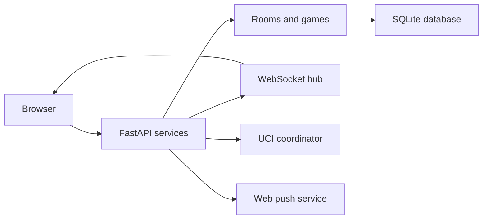

# Architecture

FastAPI serves a Jinja2 shell, static ES modules, JSON endpoints and a room WebSocket. Domain modules receive caller-owned database connections. Database provides short-lived SQLite connections and explicit write transactions; API Services serialize mutations with per-room asyncio locks, commit, then broadcast viewer-specific snapshots. Move history is authoritative; cached FEN accelerates snapshots.

One UCI engine process handles FIFO work. Computer replies are computed outside room locks and committed only after game/version/turn revalidation. Notification delivery and housekeeping are background work. Lessons refresh from validated files; puzzle and endgame catalogs load at startup. Training attempts are stateless server requests except browser storage.

## Interaction Diagrams

Text fallback: browser requests enter FastAPI, domain operations transact through Database, and committed state is broadcast through the live hub. Engine work and push delivery run separately.

## Deployment and boundaries

Serve with one Uvicorn worker behind an HTTPS reverse proxy. Locks, socket presence, rate limits, decline memory and engine coordination are process-local; PostgreSQL alone does not enable multiple workers. Synchronous database operations currently run within async request paths. External services are optional Stockfish downloads and web-push providers; no runtime analytics or hosted chess service is required.

