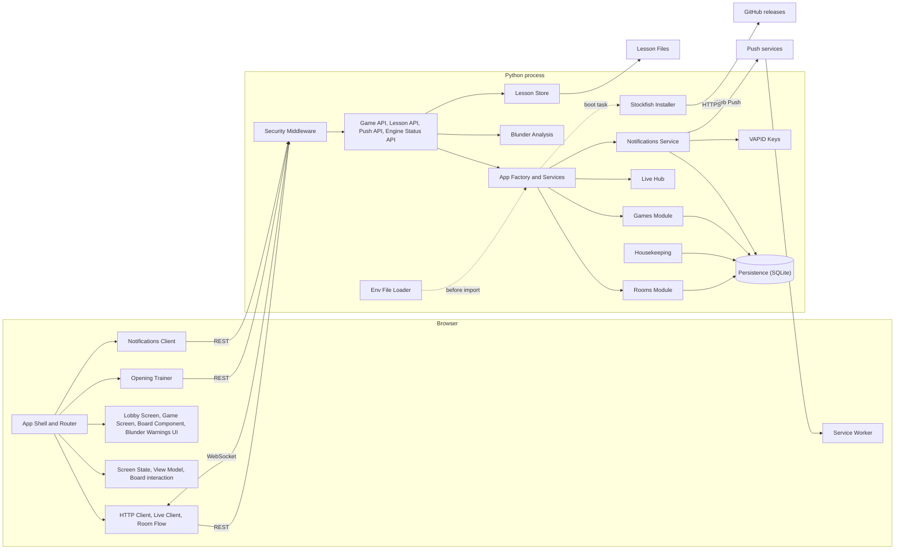
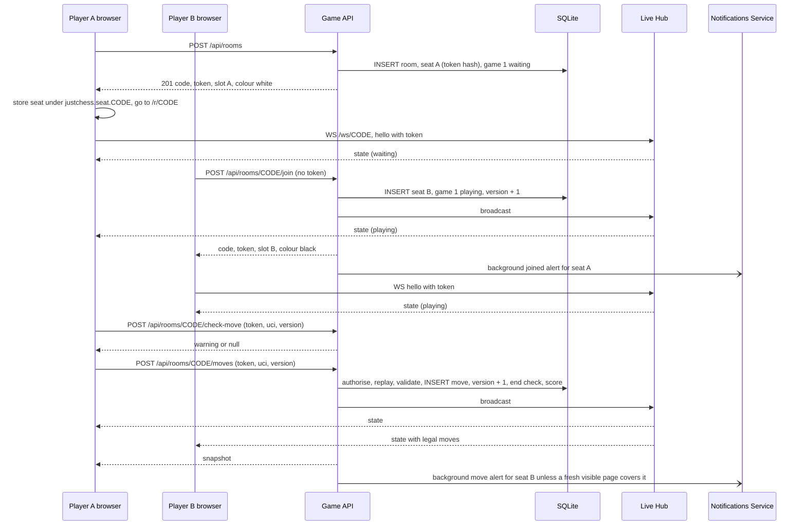
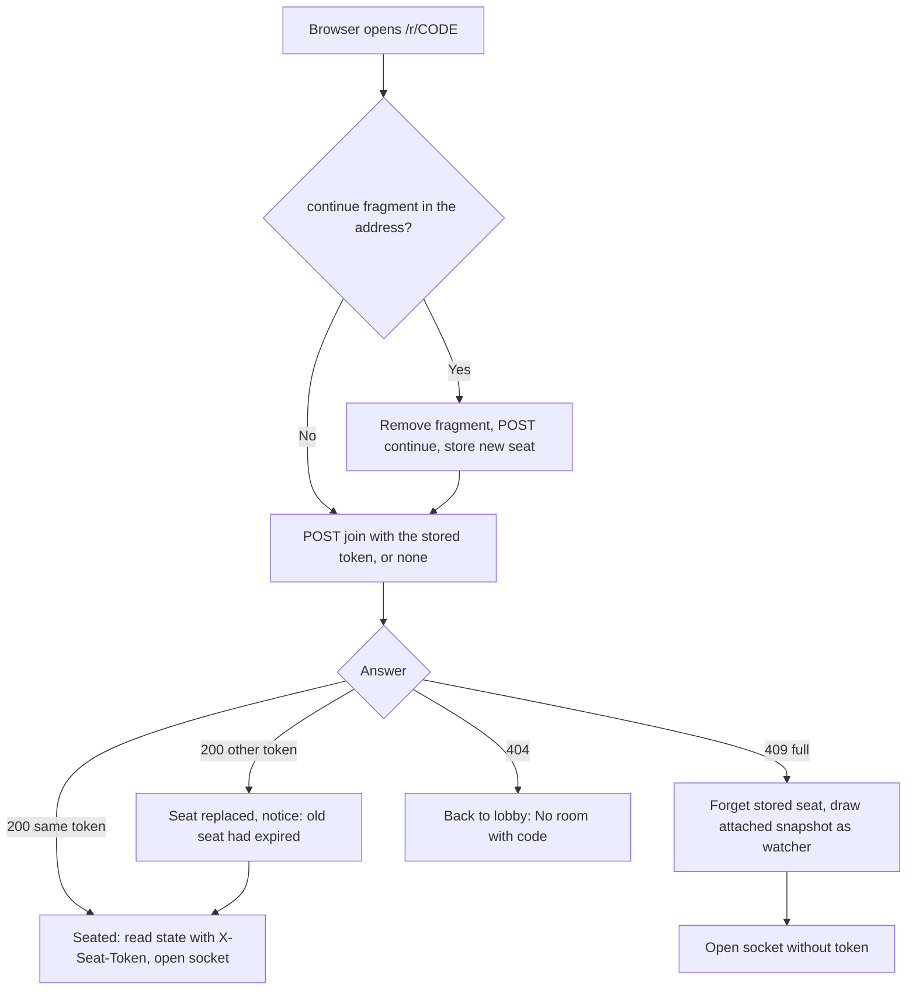
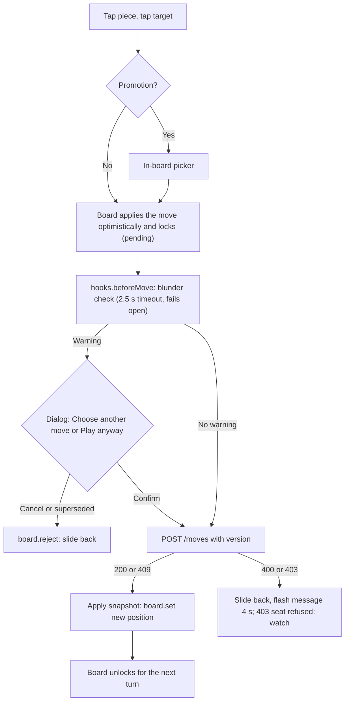
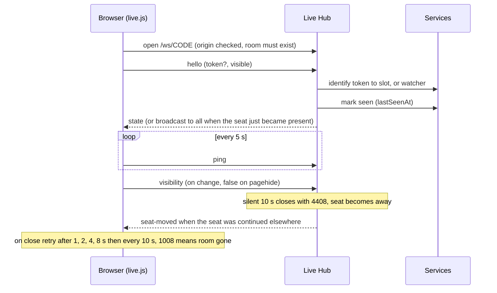
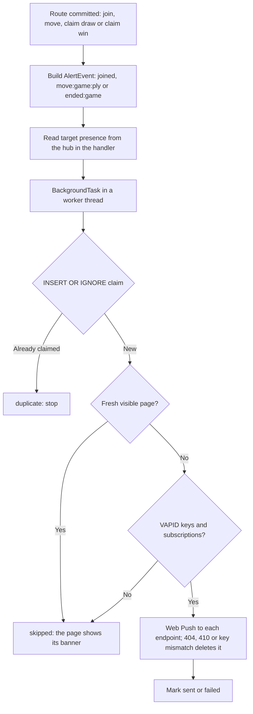
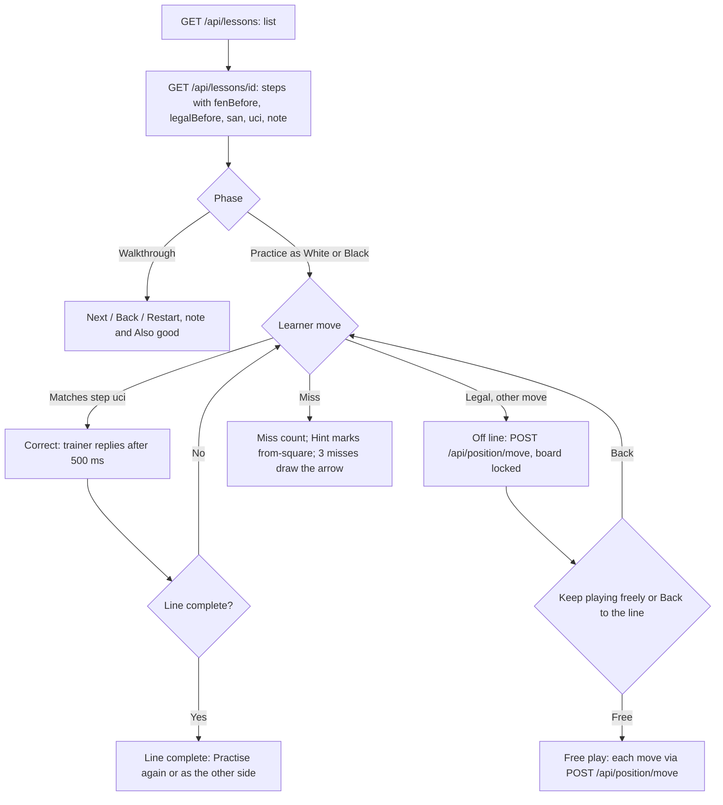
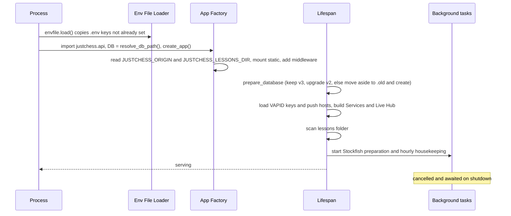

# Architecture: JustChess

## Architecture Analysis

### System Overview

A single-process FastAPI application. `app.py` loads `.env`, then builds the app with `justchess.api.create_app()`. The backend is the `justchess` package, one module per component: rooms and seats, games and rules, the live socket hub, SQLite persistence, housekeeping, security middleware, blunder analysis, lessons, notifications and VAPID keys. A standalone module, `stockfish_install.py`, finds or installs a pinned Stockfish in a background task.

The frontend is one server-rendered page shell plus plain browser ES modules (no build step): a router and wiring module (`static/js/app.js`), HTTP and socket clients, pure state machines (screen state, board interaction, trainer), a pure view model, a board component, screens, the blunder dialog, the notifications client, the opening trainer, a service worker and a token-based design system in CSS.

State lives in one SQLite file (schema version 3). Room locks and open sockets live in process memory, so the app must run as one Uvicorn worker.

### Architectural Style

Modular monolith, single process, server-authoritative.

- Evidence for "modular": every business module takes an open connection and an injected clock and knows nothing about HTTP; `justchess/api.py` composes them inside one `BEGIN IMMEDIATE` transaction per request; `LiveHub` receives callbacks instead of importing the database.
- Evidence for "single process": `Services._locks` is a `weakref.WeakValueDictionary` of `asyncio.Lock`, `LiveHub._rooms` is a dict of sockets, and README requires one worker.
- Frontend style: functional core, imperative shell. Pure reducers and the view model hold every rule and are tested in Node; DOM modules only draw and wire. Extension points between units are named hooks (`static/js/hooks.js`).

### Component Relationships

Text fallback: in the browser, the App Shell and Router wires the HTTP Client, Live Client and Room Flow, the pure Screen State, View Model and board interaction, the screens, the Opening Trainer and the Notifications Client. All REST calls and the WebSocket pass the Security Middleware (origin check, 4 KB body limit) into the API route groups. The routes run use cases through the App Factory and Services: Rooms and Games write SQLite inside one transaction, the Live Hub pushes per-viewer snapshots, and the Notifications Service claims and sends alerts (Web Push through allow-listed push services to the Service Worker). The check-move route calls Blunder Analysis; the lesson routes read the Lesson Store, which reads the Lesson Files. Housekeeping deletes idle rooms. At boot a background task runs the Stockfish Installer, which may download from GitHub. The Env File Loader runs before the app module imports anything else.

### Data Flow

1. **Seat actions.** The client posts JSON with the seat token in the body (state reads use the `X-Seat-Token` header). The route normalises the room code, then `Services.mutate` takes the room's `asyncio.Lock` and opens one `BEGIN IMMEDIATE` transaction in which Rooms authorises the seat and Games applies the change (version bump, end evaluation, score update, activity touch).
2. **Fan-out.** After commit, `LiveHub.broadcast` loads the room once and sends each socket its own snapshot (seat A, seat B or watcher). The HTTP answer is the actor's snapshot. A 409 carries the latest snapshot in the error body.
3. **Alerts.** The route builds an `AlertEvent` and reads the target seat's presence from the hub, then a `BackgroundTask` runs `Notifier.dispatch_safely` in a worker thread: claim the event key once, skip when a fresh visible page covers it, else send Web Push to the seat's stored endpoints.
4. **Client rendering.** `live.js` drops snapshots older by (game, version); `screen-state.js` derives the view (`waiting`, `playing`, `gameOver`, `watching` ...); `view-model.js` turns snapshot plus context into everything drawn; `screens/game.js` sends the board only what changed.
5. **Blunder check.** Before a move posts, `hooks.beforeMove` (blunder.js) calls `check-move`; the server copies the stored moves under the lock with a read-only connection, then replays and analyses in a worker thread outside the lock. It never writes.
6. **Lessons.** On each request `LessonStore.catalog()` compares a folder stamp (names, sizes, mtimes) and rescans when it changed; each valid file is expanded into steps with FEN before and after, legal moves before, and SAN/UCI. Free play off the line posts `{fen, uci}` to a stateless route.
7. **Configuration.** `envfile.load()` copies `.env` into `os.environ` without overriding; then `JUSTCHESS_DB` is read at import of `app.py`, `JUSTCHESS_ORIGIN` and `JUSTCHESS_LESSONS_DIR` in `create_app` (also at import), `JUSTCHESS_VAPID_*` and `JUSTCHESS_PUSH_HOSTS` in the lifespan, and `STOCKFISH_*` in the boot task.

### Key Design Decisions

| Decision | Implication |
|---|---|
| Server-authoritative rules with python-chess; the board is rebuilt by replaying stored UCI moves | Repetition and move-count rules see the whole history; `games.fen` is only a display cache |
| Per-game `version` with stale-version 409 carrying the latest snapshot | Races end in a redraw, never a 500; clients must send the version they saw |
| Seat tokens hashed (SHA-256) and compared in constant time; never in URLs or logs | No accounts; a seat lives in one browser's storage unless moved with a continue link |
| Two fixed seats per room, colours by game (`white_slot`) | Score follows the player across rematches; a third client can only watch; a local two-player mode has no place in the model today |
| Per-viewer snapshots, legal moves only for the seat to move | Watchers and the waiting side never get a move list |
| In-memory locks and socket hub | One worker only; scaling needs shared locking and pub/sub |
| Plain ES modules and CSS, no bundler, self-hosted assets | Easy to serve and audit; module boundaries must be kept by hand |
| Pure reducers and view model, DOM modules as thin shells | Rules are testable in Node with fakes; the DOM layer stays small |
| Hooks between units (`beforeMove`, `notifications`, `onSnapshot`, `lessonsMount`) | Later units plug in without editing U3; hook failures are contained |
| Blunder analysis with python-chess only, 250 ms sweep budget, run off the lock | No engine dependency; fails open after 2.5 s on the client |
| Lessons are data files, loaded and validated at runtime | New openings need no code; bad files are skipped with a logged reason |
| Stockfish installed in a background task that never raises | Boot never waits for the engine; the engine is not used yet |
| `.env` loaded by a small in-repo parser before any other import | Shell and test values always win; no python-dotenv dependency |

### Improvement Opportunities

- Give the board a height-aware size (for example a `min()` of the column width and the viewport height minus the top bar and status) so the in-game board and status fit above the fold.
- Animate the mover's own captures by keeping the captured piece as a ghost when the optimistic move is applied, using the same `--t-capture` token.
- Add a server route that answers for several stored seats at once (or a lightweight per-room summary) before building the lobby's ongoing-games list, so the lobby does not open one socket per room.
- Decide where pass-and-play lives (a client-side mode on one device that keeps seat B free, or a server-side local seat) before touching `join_room`, because the request says a remote join must turn the game back into an online one.
- Wrap Stockfish behind a small async engine service (python-chess `chess.engine` talks UCI) with a time or depth limit and one engine process, run off the event loop; keep it out of the room lock.
- Split `justchess/api.py` (714 lines) by route group as new routes arrive (single player, situation trainers, share).
- Keep end-reason wording in one place or pin all four copies with a test.
- Debt list: `code-quality-assessment.md`.

## Interaction Diagrams

### Start, join and play a move

Text fallback: A creates a room and stores the returned seat token in the browser, opens the socket with a hello carrying the token and sees "waiting". B joins without a token and gets seat B; the game becomes "playing", both sockets get their own snapshots, and seat A is alerted in the background. Each move is first checked for blunders, then posted with the version the client saw; the server authorises the seat, replays the stored moves, validates and stores the move, evaluates the end and the score, broadcasts per-viewer snapshots and alerts the opponent.

### Opening a room link (rejoin, stale seat, full room)

Text fallback: a room link first redeems any continue fragment (removed from the address bar at once), then joins with the stored token or none. The same token means the seat is restored; a different one means the stored seat was stale and was replaced (a notice says so); 409 means the room is full, so the stored seat is forgotten and the page watches; 404 returns to the lobby with "No room with code ...". A seated page reads the state with the seat header and opens the socket.

### Client move pipeline

Text fallback: a move is shown on the board at once and the board locks. The blunder hook checks it; a warning opens the dialog, and cancelling (or a newer snapshot) slides the piece back. Otherwise the move is posted with the snapshot's version. A 200 or a 409 applies the returned snapshot; a 400 or 403 slides the piece back and flashes the server's message, and a 403 "This isn't your seat" also forgets the seat and switches to watching. Whatever happens, a board still pending after the answer is rejected so it never stays locked.

### Live connection and presence

Text fallback: the client opens the room socket and sends a hello with its token (or none) and whether the page is visible. The hub resolves the seat, records lastSeenAt and sends the state (to everyone when the seat just became present). The client pings every 5 s and reports visibility changes. A socket silent for 10 s is closed and the seat shows as away; a moved seat gets "seat-moved" and becomes a watcher. The client reconnects with backoff, and stops when the close code says the room does not exist.

### Alert dispatch

Text fallback: after a join, move or claim commits, the route builds the alert, reads the target seat's presence, and queues a background task. The task claims the event key once (a repeat is a duplicate), skips when a fresh visible page will show its own banner or when push is off or the seat has no subscriptions, and otherwise sends Web Push to each stored endpoint, deleting gone endpoints and recording sent or failed. On the client, `notify-core.js` derives the same event keys from snapshots and shows a banner or a local notification, sharing the tag so push and local never stack.

### Opening trainer: walkthrough and practice

Text fallback: the trainer lists the lessons and loads one with its expanded steps. Walkthrough steps through the line with notes and alternatives. Practice compares each learner move with the step's UCI: a match advances and the trainer plays the scripted reply after 500 ms; any other legal move (alternatives included) is "Legal, but not this line" and is played through the stateless position route, after which the learner keeps playing freely or returns to the line; misses count up, Hint marks the piece, and a third miss draws the arrow. At the end the learner can practise again or as the other side.

### Boot

Text fallback: before anything else the process copies `.env` values that the shell has not set. Importing the API and building the app reads the database path, the origin and the lessons folder. The lifespan prepares the database (keep version 3, upgrade version 2 in place, otherwise move the old file aside and start fresh), loads VAPID keys and push hosts, builds the services, scans the lessons and starts two background tasks: Stockfish preparation and hourly housekeeping. Both are cancelled and awaited on shutdown.
