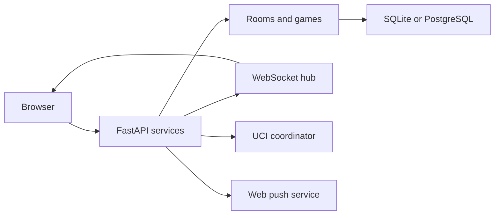
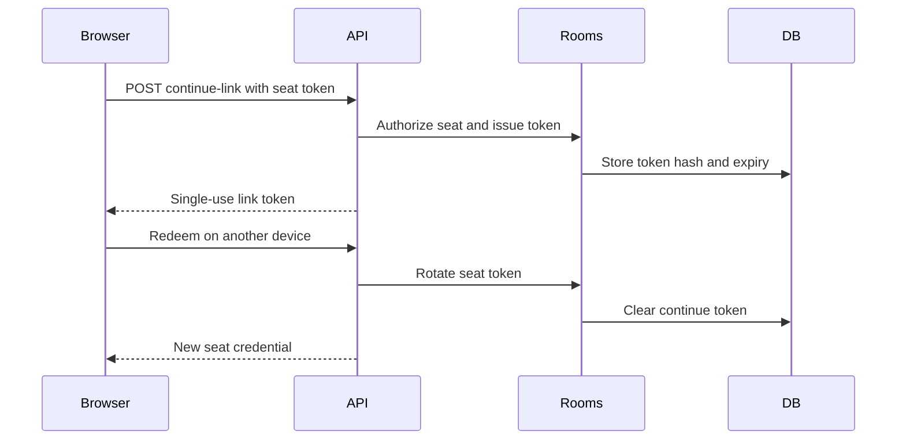
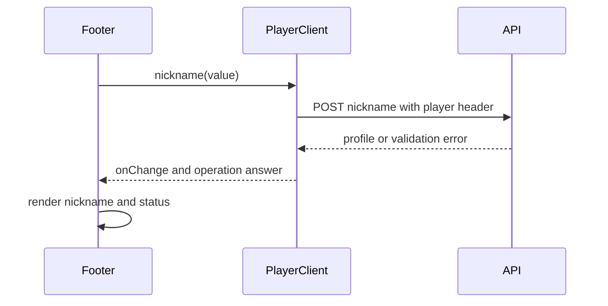

# Architecture

> Historical baseline retained from earlier scans. The Current footer sections below supersede conflicting identity/presentation statements. Outside-focus prose is preserved, not newly verified.

FastAPI serves a Jinja2 shell, static ES modules, JSON endpoints and a room WebSocket. Domain modules receive caller-owned database connections. Database provides short-lived SQLite or PostgreSQL connections and explicit write transactions; API Services serialize mutations with per-room asyncio locks, commit, then broadcast viewer-specific snapshots. Move history is authoritative; cached FEN accelerates snapshots.

One UCI engine process handles FIFO work. Computer replies are computed outside room locks and committed only after game/version/turn revalidation. Notification delivery and housekeeping are background work. Lessons refresh from validated files; puzzle and endgame catalogs load at startup. Training attempts are stateless server requests except browser storage.

## Interaction Diagrams

Text fallback: browser requests enter FastAPI, domain operations transact through Database, and committed state is broadcast through the live hub. Engine work and push delivery run separately.

## Deployment and boundaries

Serve with one Uvicorn worker behind an HTTPS reverse proxy. Locks, socket presence, rate limits, decline memory and engine coordination are process-local; PostgreSQL alone does not enable multiple workers. Synchronous database operations currently run within async request paths. External services are optional Stockfish downloads and web-push providers; no runtime analytics or hosted chess service is required.

## Focused identity and presentation seams

Seat authority is scoped to room plus slot; no player table or cross-room principal exists. Browser storage holds plain seat tokens, while rooms.py stores hashes. A nickname must remain presentation data rather than replace seat authorization. Durable recovery needs an explicit lifetime, revocation, multi-device and seat-association policy, separate from the existing rotating continue token. User clarification: the app is not live; database deletion/recreation is permitted and backward compatibility is not required. No database was touched during this scan.

Selection state lives in interaction.js; board.js toggles is-selected on the square. Growth can extend board.css while avoiding transforms that interfere with Web Animations move/capture effects. Existing win-sequence owns cancellation, reduced motion and finished-on-load suppression; view-model.js owns viewer-relative labels and winner colour. Extend these seams rather than infer winners from board orientation.

Text fallback: existing continue links authorize a current room seat, store a short-lived hash, then rotate the seat credential on redemption and downgrade the old device to a watcher. This flow cannot supply permanent identity recovery unchanged.

## Current footer architecture

mountPlayerFooter in player-identity.js binds template controls to createPlayerIdentity. Player operations use POST /api/player/{action}; onChange triggers footer render. render currently avoids overwriting a focused nickname field, but tracks no edit/saved/pending state. Regeneration calls win.confirm before an asynchronous request. Clipboard failure focuses the recovery anchor.

The share controller uses native dialog.showModal with labelled content, background inertness, Tab wrapping, Escape/backdrop dismissal and trigger focus restoration. The custom blunder alertdialog instead captures keyboard/focus and defaults to cancellation. These are existing modal precedents; the footer can adopt a small purpose-specific confirmation without importing game-specific snapshot behavior.

Text fallback: footer submits through the player client, receives an authoritative profile or error, then renders profile state and operation feedback. New saved/edit UI should transition only after successful submission.

