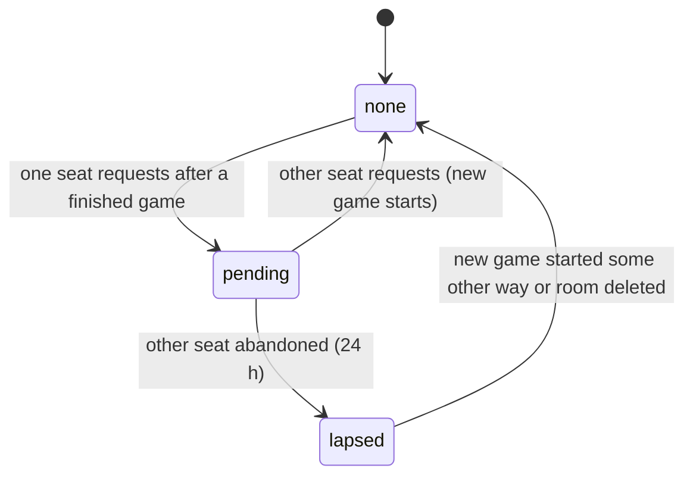
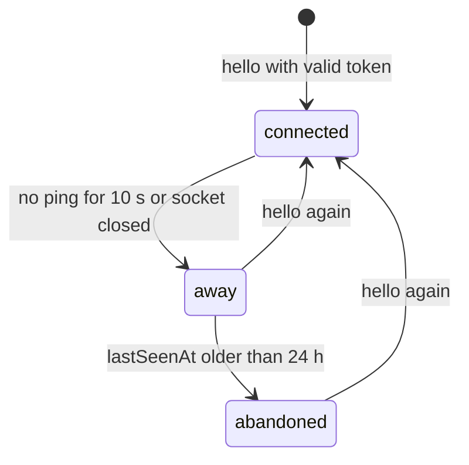
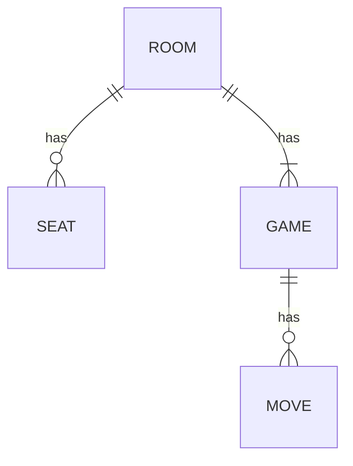

# Functional Specification — u1-core-game

This is the behavioural source of truth for unit U1 (`inception/units-generation/unit-of-work.md`). It implements the U1 rows of `inception/units-generation/unit-of-work-story-map.md` from `inception/requirements-analysis/requirements.md`, within the components of `inception/domain-design/components.md`.

The data shape is defined in `entities.md` and the decision logic in `rules.md`. This file gives the ordered workflows and the state machines.

It also settles the open review points from Domain Design:
- **R-01:** Housekeeping deletes Games data through Games' delete-by-room operation.
- **R-02:** one database transaction per use case, run by HttpApi; there is no stored current-game pointer.
- **R-03 and R-04:** HttpApi reads presence and "abandoned" from LiveUpdates and Rooms and passes them on.

It also settles the open review point from Units Generation:
- **R-01:** the old client is not supported between U1 and U3 (see "Compatibility" below).

## Package layout (module boundaries)

The single `app.py` becomes a `justchess/` package, with one module per component:
- `rooms`
- `games`
- `live`
- `housekeeping`
- `db` (connection and schema)
- `api` (HttpApi routes and orchestration)

`app.py` stays as a thin entry point that creates the app, so `uv run fastapi dev` and `uvicorn app:app` keep working. `stockfish_install.py` and `/api/engine` are kept unchanged and wired into the new startup.

## Workflows

### W1 — Create room (FR1.1)
1. The client sends `POST /api/rooms` (same origin, empty body).
2. HttpApi opens a transaction. Rooms creates the Room with a unique code (BR1.1) and seat A with a fresh token (BR1.4). Games creates Game 1 with whiteSlot A and status waiting.
3. The transaction commits.
4. The response returns `{code, token, slot: "A", colour: "white"}`. The token is shown to this client only, once.

### W2 — Join by code or link (FR1.2, FR1.3, FR1.4, FR1.5)
1. The client sends `POST /api/rooms/{code}/join` with an optional token. An invite link `/r/{code}` serves the page, which then calls this.
2. The code is validated (BR1.2). Then, under the room's lock:
   - a matching token means rejoin: return the same seat and do nothing else;
   - otherwise, if seat B is free, create seat B and set Game 1 to playing;
   - otherwise, refuse with "This game already has two players" (BR1.3).
3. LiveUpdates broadcasts the snapshot.
4. The response returns `{code, token, slot, colour}`.

### W3 — Move (FR3.2, FR3.10, FR4.2, FR4.5)
1. The client sends `POST /api/rooms/{code}/moves` with `{token, uci, version}`.
2. HttpApi opens a transaction. Rooms authorises the seat (BR1.6). Games validates and applies the move (BR2.1), appends the Move, increments the version, and evaluates the end (BR2.2).
3. If the game ended, Rooms updates the score (BR3.1) in the same transaction.
4. The transaction commits and Room.lastActivityAt is updated.
5. LiveUpdates broadcasts the snapshot. U5 later adds notifications here.
6. On any refusal nothing changes, and the response explains why. A version mismatch returns the latest snapshot.

### W4 — Claim draw (FR4.3)
`POST /api/rooms/{code}/claim-draw` with `{token}`. The seat is authorised; Games checks that the draw is claimable and that it is the claiming seat's turn (BR2.3). The game ends, the score is updated (draws + 1) in the same transaction, and the snapshot is broadcast.

### W5 — Claim win after abandonment (FR11.2)
`POST /api/rooms/{code}/claim-win` with `{token}`. HttpApi asks Rooms whether the opponent seat is abandoned (BR1.7) and passes that fact to Games (BR2.4). The game ends and the score is updated in the same transaction, then broadcast.

### W6 — Rematch (FR4.4)
`POST /api/rooms/{code}/rematch` with `{token}`. Rooms applies BR3.2. When both seats have asked, Games creates the next game with colours flipped, and the snapshot is broadcast. If the other seat is abandoned, the snapshot shows the request as lapsed (BR3.3).

### W7 — Continue on another device (FR1.7)
1. `POST /api/rooms/{code}/continue-link` with `{token}` returns `{continueToken}`. The client builds the link `/r/{code}#continue=<token>`; the fragment never reaches server logs.
2. `POST /api/rooms/{code}/continue` with `{continueToken}` redeems it (BR1.5) and returns `{token, slot, colour}` for the new device.
3. The old device's socket receives `{type:"seat-moved"}` and becomes a watcher.

### W8 — Live connection (FR1.6, FR3.4)
1. The client opens `/ws/{code}`. The Origin is checked (BR4.3) and the room must exist.
2. The client sends `{type:"hello", token?, visible}` (BR4.4). The server replies with a full snapshot.
3. The client sends a ping every 5 s and a `{type:"visibility", visible}` message on change. The server updates lastSeenAt and presence. A seat with no ping for 10 s is away, and the snapshot is broadcast.
4. On disconnect: remove the socket, and if the seat has no other live socket, mark it away and broadcast.

### W9 — Startup and cleanup (FR11.1, FR11.2, FR9.1)
1. Open the database and apply BR4.1.
2. Run Housekeeping once, then every hour (BR4.2). Housekeeping calls Rooms (list idle rooms), Games (delete games and moves by room) and Rooms (delete seats and room), in one transaction per room.
3. Start the Stockfish preparation in the background, unchanged.

## State machines

### Game lifecycle

```mermaid
stateDiagram-v2
  [*] --> waiting: room created
  waiting --> playing: seat B joins (game 1) or both request rematch (game n+1)
  playing --> playing: legal move, no end
  playing --> finished: checkmate, stalemate, insufficient material, fivefold, 75 moves
  playing --> finished: draw claimed (threefold or 50 moves)
  playing --> finished: win claimed after abandonment
  finished --> [*]
```

<!-- Text fallback: a game starts waiting, becomes playing when seat B joins or a rematch starts, stays playing on ordinary moves, and becomes finished on an automatic end, a draw claim or a win claim. A finished game never changes again. -->

### Rematch request (per room)

<!-- Text fallback: with no request pending the state is none; one seat's request makes it pending; the other seat's request starts the next game and resets it; if the other seat is abandoned it reads as lapsed. -->

### Seat presence

<!-- Text fallback: a seat is connected while it pings, away after 10 s of silence, abandoned after 24 h away, and connected again on its next hello. -->

## Entity relationships (derived from entities.md)

<!-- Text fallback: a room has up to two seats and one or more games; a game has many moves. -->

## Rules summary (derived from rules.md)

- **Rooms:** BR1.1–BR1.7 (codes, joining, tokens, continue link, authorisation, presence).
- **Games:** BR2.1–BR2.5 (move acceptance, automatic ends, draw claims, abandonment wins, snapshot).
- **Match:** BR3.1–BR3.3 (score, rematch, lapse).
- **Lifecycle and security:** BR4.1–BR4.4 (fresh schema, cleanup, origin and size limits, socket identity).

## Error handling

| Situation | Response |
|---|---|
| Invalid code format | 400 "Room code must be 6 letters or digits" |
| Unknown room | 404 "Room not found" |
| Room full | 409 "This game already has two players" |
| Wrong or missing token | 403 "This isn't your seat" |
| Not your turn | 403 "Not your turn" |
| Illegal move | 400 "Illegal move" |
| Version mismatch | 409 with the latest snapshot |
| Game over | 409 "Game is over" |
| Draw not claimable | 409 "A draw can't be claimed right now" |
| Win claim too early | 409 "Your opponent hasn't been away long enough" |
| Foreign origin | 403 |
| Body over 4 KB | 413 |
| Database error | 500 with a generic message; the transaction rolls back; the error is logged with the room code, never with tokens |

## Compatibility

Units Generation review finding R-01 is settled as follows: the old `static/app.js` is **not** supported between U1 and U3. U1 changes the routes (`/api/rooms`), token handling and the socket handshake.

U1 is verified by its own automated tests. During that window the running page can create a room but cannot play correctly. U3 replaces the client. The snapshot keeps the legacy field names (BR2.5) only so the transition stays small, not as a promise.

## Test scope (Standard strategy)

U1's backend tests cover:
- **Rules:** legal and illegal moves; each automatic end and its reason; threefold and 50-move positions become claimable without ending; claims accepted and refused.
- **Version conflicts:** a stale version and a duplicate move are both rejected.
- **Seats:** the third join is refused; rejoin by token; the token is stored only as a hash; a wrong token is refused; a continue link moves the seat and the old token stops working.
- **Score and rematch:** the score follows the slot across a colour swap; a rematch needs both seats; the request lapses when the other seat is abandoned (simulated clock).
- **Abandonment:** a win claim is refused before 24 h and accepted after.
- **Schema:** an old database is moved aside and a fresh one is created.
- **Cleanup:** a room idle for 30 days is deleted with its games and moves.
- **Security:** a foreign origin is refused on POST and on the socket; an oversized body is refused.
- **WebSocket:** the snapshot arrives on hello; presence becomes away after the heartbeat timeout.
