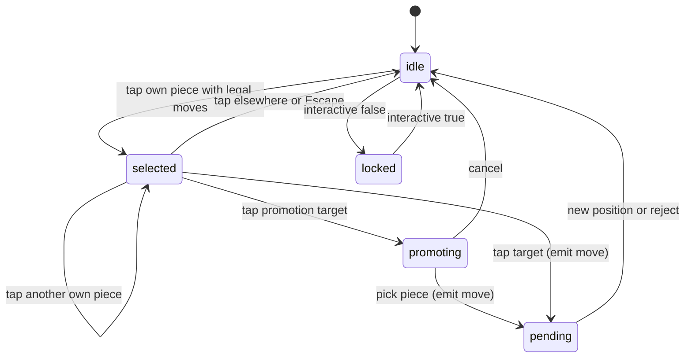
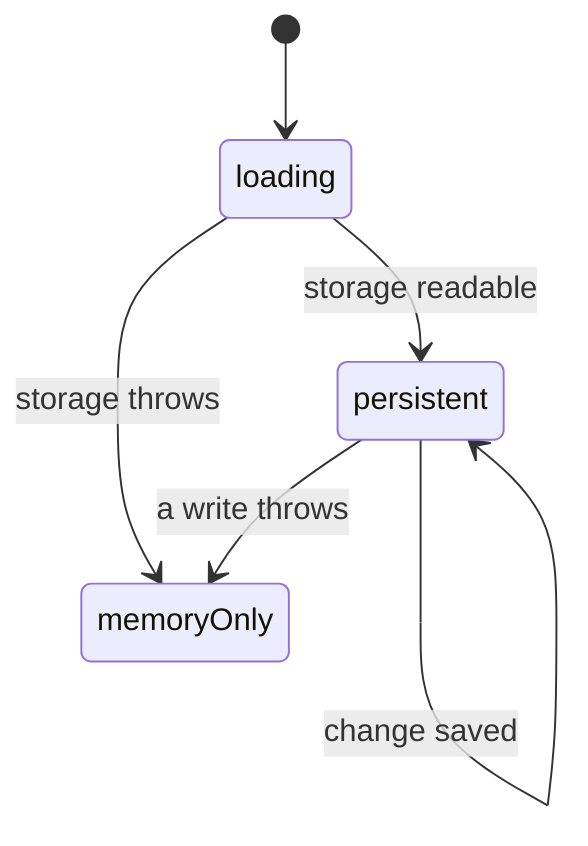

# Functional Specification — u2-design-system-board

This is the behavioural source of truth for unit U2 (`inception/units-generation/unit-of-work.md`). It covers the U2 rows of `inception/units-generation/unit-of-work-story-map.md`: FR3.1, FR3.3, FR3.6, FR3.9, FR5.1–FR5.3 and FR10.1–FR10.5, plus U2's share of NFR6. All of these come from `inception/requirements-analysis/requirements.md`.

The values are taken from `inception/refined-mockups/` (`design-system-mapping.md`, `interaction-spec.md` and `accessibility-checklist.md`), and the published mockup is the visual reference. The decision logic is in `rules.md`, and the component contracts are in `frontend-components.md`.

U2 is a UI unit with no data of its own. It ships:
- the shared styles;
- the fonts and pieces;
- a board component;
- a settings store;
- a demo page that exercises them without a server.

U3 is the first consumer.

## Boundaries

- **Inputs to the board:** a position (FEN), the legal moves (UCI list), orientation, last move, check flag, interactive flag, and the coordinate mode. These fields map one-to-one to U1's snapshot: `fen`, `legalMoves`, `colour`, `lastMove`, `check`. The interactive flag is true while the game is playing and it is this seat's turn.
- **Outputs from the board:** a single `move` event carrying a UCI string. The board never talks to the server.
- **Settings:** a store that U3 (theme and board), U4 (blunder warnings) and U5 (notifications) read and subscribe to. U2 renders the settings panel controls. The two rows that belong to other units, "Get a private continue link" (U3) and the notifications permission prompt (U5), are hooks the panel exposes, not U2 behaviour.
- **Technology constraint (ADR from Domain Design):** native ES modules served as static files. There is no build step and no npm runtime dependency. Node's built-in test runner runs the pure-function tests.

## Workflows

### W1 — Page loads with the design system (FR10.1, FR10.2, FR10.3, FR10.5)
1. The page links the token stylesheet and the base stylesheet, and preloads the two main font files.
2. The settings store reads the saved settings (BR6.1). If storage is blocked, it uses the defaults and marks itself not persistent (BR6.2).
3. The store applies `data-theme` (omitted for Device) and `data-board` on the root element (BR5.1, BR5.2) before first paint. A small inline script does this, so the page never flashes the wrong theme.
4. When the device colour scheme changes and the theme is Device, the page follows it with no reload.

### W2 — Select and move by pointer (FR3.1, FR3.3)
1. The board is rendered with the viewer's side at the bottom (BR1.2), the square colours (BR1.1) and the labels (BR1.3).
2. The person taps one of their own pieces. If it has legal moves, it is selected and exactly its targets are marked (BR2.1). Otherwise nothing is selected.
3. Tapping another of their own pieces moves the selection to it. Tapping an empty non-target square, or the selected piece again, clears the selection.
4. Tapping a target:
   - for an ordinary move, emits `move` with the UCI and locks input (BR2.3), and the piece is shown on the target at once ("optimistic" placement);
   - for a promotion target, opens the picker (BR2.2). Choosing a piece emits the move with its suffix. Cancelling closes the picker and leaves the selection cleared.
5. The caller answers by:
   - **a new position:** the board animates any difference (BR4.1) and unlocks;
   - **a reject call:** the piece slides back and the board unlocks.

### W3 — Select and move by keyboard (NFR6, BR2.4)
1. Tab reaches the board. Focus lands on the last focused square, or the viewer's king when there is none.
2. Arrow keys move focus in visual space. Enter or Space acts as a tap on the focused square (W2 steps 2–4).
3. Escape clears the selection, or closes the picker when it is open.
4. Inside the picker, the arrow keys move between the four pieces, Enter picks one, and Escape cancels. Focus starts on the queen.
5. After a move, focus stays on the destination square.

### W4 — Opponent's move arrives (FR10.4, FR3.6)
1. The caller sets a new position with `lastMove`.
2. The board matches the change to that move and slides the piece (BR4.1). A capture fades the taken piece. Castling also moves the rook, and en passant removes the passed pawn.
3. If the check flag goes from false to true, the king's square pulses twice (BR4.2).
4. The last-move highlight moves to the new squares.
5. With reduced motion set, steps 2–3 jump straight to the final state (BR4.3).

### W5 — Change a setting (FR3.9, FR5.3, FR10.2, FR10.3)
1. The person changes a control in the settings panel.
2. The store validates the value and saves it if it can. Subscribers are told at once.
3. The board re-renders its labels (for coordinates). The root element attributes change (for theme and board). U4 and U5 read their keys when they need them.
4. If the store is not persistent, the panel shows "Settings won't be kept after you close this tab."

## State machines

### Board interaction

<!-- Text fallback: the board starts idle. Tapping your own piece that can move selects it. Tapping another of your pieces moves the selection, and tapping elsewhere or pressing Escape clears it. Tapping a target emits the move and waits (pending). A promotion target first opens the picker, where cancel returns to idle and picking emits the move. A new position or a reject call ends pending. When the caller sets interactive false the board is locked until it is set true again. -->

### Settings persistence

<!-- Text fallback: the store loads settings; if storage works it is persistent and saves every change; if reading or any later write throws it becomes memory-only for the rest of the tab and the panel shows the notice. -->

## Rules summary (derived from rules.md)

- **Geometry:** BR1.1–BR1.3 (colours, orientation, labels).
- **Interaction:** BR2.1–BR2.4 (selection, promotion, locking, keyboard).
- **Highlights and accessible names:** BR3.1–BR3.2.
- **Motion:** BR4.1–BR4.3 (slide, capture, check pulse, reduced motion).
- **Identity:** BR5.1–BR5.4 (themes, board themes, type and buttons, pieces).
- **Settings:** BR6.1–BR6.2.

## Edge cases

| Case | Behaviour |
|---|---|
| Legal moves list empty while interactive | Nothing can be selected; no error |
| Position update while a selection is open | The selection is cleared when the selected piece no longer has legal moves |
| Position update while the picker is open | The picker closes with no move |
| Two position updates during one animation | The running animation finishes at once and the new one starts from the current state |
| Malformed FEN | The board keeps the last good position and logs a console error, which is the caller's bug |
| Board narrower than 8 × 44 px | Not expected (the minimum is 374 px). Squares shrink proportionally, and the 44 px target rule is checked in U3's layout |
| Window resize or orientation flip | Squares are sized by CSS grid, so no script runs on resize |

## Test scope (Standard strategy)

Pure-function tests run with `node --test`:
- geometry: square colour, orientation order and label placement;
- FEN parsing to pieces;
- targets for a square from legal moves, and promotion detection;
- move derivation for animation, including castling and en passant;
- keyboard focus moves at the edges for both orientations;
- the accessible name builder;
- the settings store: defaults, corrupt values, blocked storage and subscriber calls.

The demo page `static/demo/board.html` is the visual check for themes, motion, reduced motion and the picker. Build and Test runs the accessibility checks (axe, contrast) listed in `accessibility-checklist.md`.
