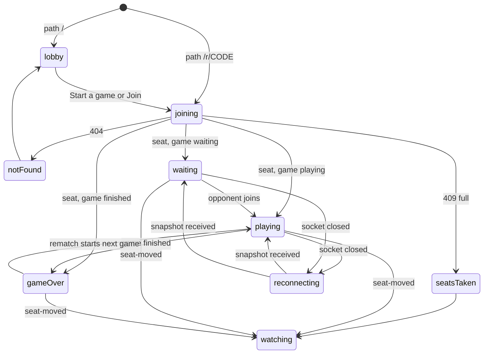

# Functional Specification — u3-game-screen

This is the behavioural source of truth for unit U3 (`inception/units-generation/unit-of-work.md`). It covers U3's rows of `inception/units-generation/unit-of-work-story-map.md`:
- FR1.2, FR1.3, FR1.5, FR1.6, FR1.7
- FR2.1, FR2.2
- FR3.4, FR3.5
- FR4.1, FR4.3, FR4.4, FR4.5
- FR5.4, FR5.5, FR5.6
- FR10.1, FR10.4, FR10.6
- FR11.2
- U3's share of NFR5 and NFR6

All of these come from `inception/requirements-analysis/requirements.md`. The screens, texts and layout come from `inception/refined-mockups/` (`mockups.md`, `interaction-spec.md`, `design-system-mapping.md`). The decision logic is in `rules.md`, and the component contracts are in `frontend-components.md`.

U3 replaces the old client (`static/app.js`, `static/style.css` and the body of `templates/index.html`). It is built on:
- **U1:** the HTTP routes under `/api/rooms`, the `/ws/{code}` socket and the snapshot fields;
- **U2:** `createBoard`, the settings store and panel, the tokens and the fonts.

## Boundaries and integration points

| With | What U3 uses | Notes |
|---|---|---|
| U1 HTTP | `POST /api/rooms`; `POST /api/rooms/{code}/join`, `/moves`, `/claim-draw`, `/claim-win`, `/rematch`, `/continue-link`, `/continue`; `GET /api/rooms/{code}` with the `X-Seat-Token` header | Bodies are as in U1's functional spec. A 409 from a room action carries `snapshot`. |
| U1 socket | `/ws/{code}`: send `hello`, `ping` and `visibility`; receive `state` and `seat-moved` | The token goes only in `hello` |
| U1 snapshot | `fen`, `turn`, `status`, `endReason`, `result`, `check`, `moveList`, `lastMove` (UCI), `version`, `game`, `claimableDraw`, `seats`, `score`, `rematch`, `slot`, `colour`, `legalMoves` | Legacy fields are ignored. One additive field is needed; see "Additive server change". |
| U2 | `createBoard(el, opts)`, `board.set`, `board.reject`, `createSettings`, `applyToDocument`, `renderSettingsPanel(…, {extraRows})`, `boot.js`, the CSS | `lastMove` UCI maps to `{from, to}` |
| U4, U5, U6 | Mount points: the move hook (U4 runs its blunder check before posting), the notifications hook (U5), and the drawer content (U6) | U3 ships them as no-ops |

### Additive server change

The "Claim draw" label names the reason (BR3.7), so U3 adds `claimableDrawReason` to U1's snapshot, with the value `"threefold"`, `"fifty_moves"` or `null`. The existing bool `claimableDraw` stays. It is computed from the same `claimable_draw` result in `justchess/games.py`, so no rule changes. U1's tests are extended with one assertion.

### Notes carried from U1's code review

- U1 checks the version before the side to move, so a stale request from the wrong seat gets 409 with a snapshot, not 403. U3 handles both answers the same way: it applies a snapshot when one is present, and otherwise slides the piece back and shows the message. It does not depend on the order. Amending BR2.1 in U1's contract is left to Build and Test.
- The seat token goes only in the request body or the `X-Seat-Token` header, never in a query string (U1 review concern).

## Workflows

### W1 — Start a game (FR1.1, BR1.1)
1. The lobby shows the framed starting board, "Start a game", and "Have a room code?" with a Join button.
2. "Start a game" posts `/api/rooms`. The seat is stored (BR1.3) and the screen moves to `/r/{code}` (W3) without a reload.
3. The game screen opens in the waiting state with Share as the main action.

### W2 — Join with a typed code (FR1.2, BR1.2)
1. The person types a code; it is uppercased as they type. Join validates the format.
2. A valid code moves to `/r/{code}` (W3). A 404 brings back the lobby with the not-found message and the code still in the field.

### W3 — Open /r/{code} (FR1.3, FR1.5, FR1.7, BR1.4, BR1.5)
1. If the address has `#continue=…`, it is redeemed first (BR1.5) and the fragment removed.
2. Join with the stored token, or with none (BR1.4). The result is a seat (A or B), a watcher (room full), or not found.
3. Open the socket (W4). The game screen shows the snapshot from the join response at once, then live updates.

### W4 — Live connection (FR3.4, FR1.6, BR3.1, BR3.2)
1. Open `/ws/{code}` and send hello with the token (a watcher sends none) and the visibility.
2. Each `state` message replaces the snapshot when its (game, version) is newer (BR3.1). Everything on screen is redrawn from it.
3. A ping is sent every 5 s, and a visibility message on each change.
4. When the socket closes, the screen shows the reconnecting view and retries with backoff. A successful hello brings a full snapshot.
5. A `seat-moved` message leads to BR1.7.

### W5 — Play a move (FR3.1, FR3.2, BR3.3)
1. The board is interactive only while the status is playing, the viewer is a seat, and it is their colour's move.
2. When the board emits a move, the move hook runs first. U3's hook simply allows it; U4 replaces it with the blunder check. Then the move is posted with the snapshot's version.
3. The response is handled per BR3.3. The live region announces "<Colour> played <SAN>. Your move." or "You played <SAN>.".

### W6 — Claims (FR4.3, FR11.2, BR3.7)
1. The claim buttons appear under the status only while they are valid.
2. A tap posts the claim. The response snapshot ends the game, which leads to W7.

### W7 — Game over (FR4.1, FR4.2, FR10.4, BR4.1, BR4.2)
1. The snapshot turns finished, so the board locks (`interactive=false`).
2. If this screen saw the change happen, the win sequence plays (or the end state shows at once under reduced motion). The overlay then names the reason.
3. The scoresheet's result cell is filled, and the score updates.

### W8 — Rematch (FR4.4, FR4.5, BR4.3)
1. "Play again" posts the rematch request. The button reflects the rematch state.
2. When both seats have asked, a snapshot with a new game number arrives. The overlay closes, the board takes the new orientation, and the score keeps each player's wins.

### W9 — Share and continue (FR2.1, FR2.2, FR1.7, BR2.1, BR1.6)
1. Share, in the top bar, follows BR2.1.
2. In Game settings, "Get a private continue link" follows BR1.6.

### W10 — Lessons drawer during a game (FR5.5, FR5.6, BR3.8)
1. The drawer is collapsed, with the summary "Learn openings — your game keeps running".
2. Opening it shows U6's content. The game socket and board keep updating.
3. The banner from BR3.8 appears when the turn comes back to the viewer.

## Screen state machine

<!-- Text fallback: the root path shows the lobby, and a room path starts joining. Joining leads to not found (back to the lobby), seats taken (then watching), waiting, playing or game over. Waiting becomes playing when the opponent joins. Playing becomes game over when the game ends, and game over becomes playing again when a rematch starts. A closed socket shows reconnecting until a snapshot arrives. A seat-moved message turns any seat view into watching. -->

The storage-blocked notice is not a state of its own. It is a line shown in any seat state when the seat could not be saved.

## Rules summary (derived from rules.md)

- **Entry and seat:** BR1.1–BR1.7.
- **Sharing:** BR2.1.
- **Live game:** BR3.1–BR3.8.
- **Game over and rematch:** BR4.1–BR4.3.
- **Layout and states:** BR5.1–BR5.2.

## Edge cases

| Case | Behaviour |
|---|---|
| Two tabs of the same browser on one seat | Both stay seats, because the server allows several sockets per seat. Moves from either tab are valid. |
| Stored token for a room that was cleaned up | The join returns 404, so the stored seat is removed and the lobby shows not found. |
| Snapshot arrives during the win sequence | Board and scoresheet data update. The sequence finishes visually, so it is not restarted. |
| A new game starts during the win sequence | The sequence stops at once and the new game is drawn. |
| Clipboard denied | The read-only link field fallback appears. |
| The page is opened on a finished game | The end state shows without the sequence, and the overlay offers Play again. |
| Socket rejected with 1008 (unknown room) | The lobby shows not found. |
| Browser offline | The page shows reconnecting, and retries continue. |

## Old client removal

At the end of the unit:
- `static/app.js` and `static/style.css` are deleted;
- `templates/index.html` is rewritten to the new shell;
- the HTMX tag is already gone (U1).

The lessons routes are kept for U6.

## Test scope (Standard strategy)

- **Pure modules, with `node --test`:**
  - view model (snapshot to status, buttons, overlay, score and scoresheet rows);
  - seat store (storage throws, seat-moved, continue fragment parsing);
  - API client error mapping (409 with snapshot, 400/403, network);
  - reconnect backoff schedule;
  - share fallback choice;
  - end-reason titles.
- **Python, with TestClient:**
  - `/` and `/r/{code}` serve the new shell;
  - every module and stylesheet it references is served;
  - the old client files are gone;
  - `claimableDrawReason` appears in the snapshot.
- **End-to-end** (headless Chromium, when available, in Build and Test): two browser contexts create and join a room, play Fool's mate, see the overlay and start a rematch with the colours swapped.
