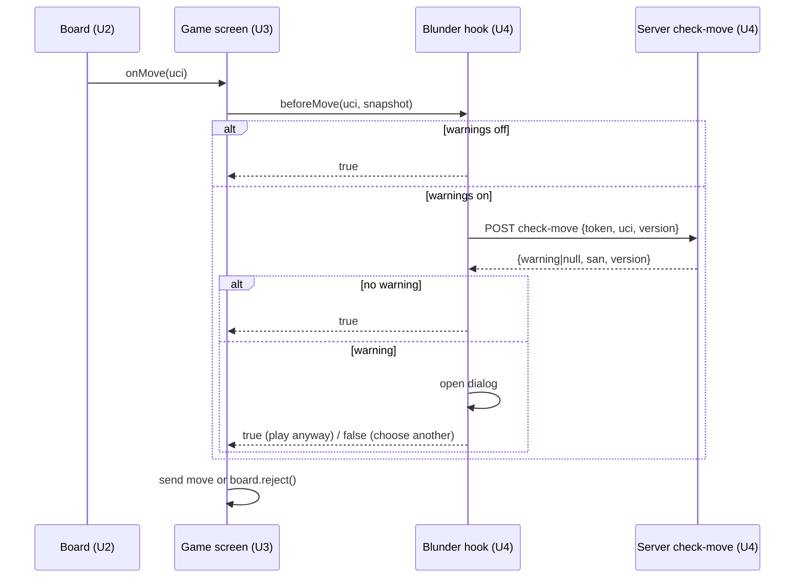
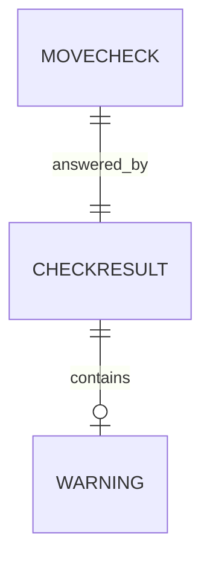

# Functional Specification — u4-blunder-warnings

This is the behavioural source of truth for unit U4 (`inception/units-generation/unit-of-work.md`). It covers U4's rows of `inception/units-generation/unit-of-work-story-map.md`: FR3.7, FR3.8, FR3.11, and honouring FR3.9, which U2 stores. All of these come from `inception/requirements-analysis/requirements.md`. It builds the Analysis component of `inception/domain-design/components.md` and the blunder dialog from `inception/refined-mockups/mockups.md` (Screen 3) and `interaction-spec.md`. The data is in `entities.md` and the decisions are in `rules.md`.

## Boundaries and integration points

| With | What U4 uses or adds |
|---|---|
| U1 | Adds `justchess/analysis.py`, which is pure: it takes a `chess.Board` and a move and returns a Warning or None. Adds the route `POST /api/rooms/{code}/check-move` to `api.py`, reusing U1's seat authorisation, version check, origin middleware and size limit. The unit definition writes it as `/api/games/{code}/check-move`. It goes under `/api/rooms/` to match every other U1 route, which is the only change of name. |
| U2 | Reads `settings.get("blunderWarnings")`. |
| U3 | Registers `hooks.beforeMove`, whose contract is `(uci, snapshot) → Promise<boolean>`. U3's game screen already waits for it and fails closed when it throws, so U4's hook never throws (BR3.4). The dialog is mounted in the game screen. |
| Stockfish | Not used in P1, as the component says. Analysis uses `python-chess` only. |

## Workflows

### W1 — Check a move (FR3.7, FR3.8, FR3.11)
1. The learner, now a player, picks a move on the board. U3 calls `beforeMove(uci, snapshot)`.
2. With blunder warnings off, the hook resolves true and the move is sent (BR3.1).
3. Otherwise the client posts `{token, uci, version}` to `/check-move`.
4. The server validates the request (BR2.1) and runs Analysis on the board, replayed from the stored moves as U1 does:
   1. Look for mate in one after the move (BR1.1). Drop it if the threat existed before the move (BR1.3).
   2. If there is none, look for hanging pieces after the move (BR1.2). Drop any that were hanging before the move (BR1.3). Pick one by BR1.5.
   3. If a warning remains, sweep every legal move for the same kind of problem. If none is free of it, drop the warning (BR1.4).
5. The server answers `{warning, san, version}`.
6. With no warning, the hook resolves true and U3 sends the move.

### W2 — Confirm or cancel (BR3.2, BR3.3)
1. The dialog opens with the title and body built from the warning. Focus is on "Choose another move".
2. "Play … anyway" resolves true, and U3 sends the move with the same version.
3. "Choose another move" or Escape resolves false. U3 calls `board.reject()`, so the piece slides back and the position is unchanged.

### W3 — A check that fails (BR3.4)
- No network, or a 5xx: the move goes ahead with no dialog.
- 409: the move is not sent, and the newer snapshot takes over.
- 400 or 403: the move is not sent, and the server's message is shown.

## Analysis algorithm (plain language)

- **Values:** pawn 1, knight 3, bishop 3, rook 5, queen 9. The king counts only as a last attacker.
- **Exchange on a square:** list the attackers of both sides on that square, including attacks revealed behind moved pieces (x-rays), and each side always captures with its least valuable piece. Each side may stop when continuing would lose. The result is the net material the side to move gains (standard static exchange evaluation, worked out move by move on a copy of the board).
- **Hanging set for a position:** pass the turn to the opponent of the mover, then mark each mover knight, bishop, rook or queen where the opponent's exchange gain is above 0. For the moved piece after a capture, the mark needs a gain above the value just captured.
- **Before and after:** the "before" set is worked out on the position before the move, with the turn passed. The "after" set is worked out on the position after the move. The moved piece's identity follows it from its old square to its new one. Castling moves the rook too, and promotion turns the pawn into a piece. A promoted piece counts as new in "after".
- **No-alternative sweep:** runs only when a warning exists, and stops at the first legal move that is free of the same problem.

## Sequence

<!-- Text fallback: the board reports a move to the game screen, which asks the blunder hook. With warnings off the hook says yes at once. Otherwise it asks the server; no warning means yes, and a warning opens the dialog, which says yes for "Play anyway" and no for "Choose another move". The game screen then sends the move or slides the piece back. -->

## Entity relationships (derived from entities.md)

<!-- Text fallback: each move check gets one result, which holds at most one warning. -->

## Rules summary (derived from rules.md)

- **What counts:** BR1.1–BR1.5.
- **The route:** BR2.1–BR2.2.
- **The dialog and the setting:** BR3.1–BR3.4.

## Edge cases

| Case | Behaviour |
|---|---|
| The move gives check, and the opponent's only replies cannot mate | No mate warning. Hanging pieces are still judged. |
| The move is checkmate | No warning: the game ends, the opponent has no reply, and nothing hangs after it. |
| A pawn left hanging | Not warned. Only knights, bishops, rooks and the queen are judged (FR3.8). |
| The king is "hanging" | The king is not judged. A move into check is illegal and never reaches Analysis. |
| An even trade (bishop takes knight, pawn takes back) | Not warned (BR1.2). |
| Promotion to a queen that can be taken at once for free | Warned as a hanging queen. |
| Stalemate after the move | No warning. Stalemate is not a blunder kind in P1. |
| En passant | The captured pawn is removed in both the before and after positions, and the exchange is worked out correctly. |

## Test scope (Standard strategy)

- **Fixed positions for each rule:**
  - Fool's mate setup (allowing Qh4#);
  - a back-rank mate allowed;
  - a hanging knight and a hanging queen;
  - an even trade, not warned;
  - a defended piece that still loses to a lower-value attacker;
  - a piece already hanging, then an unrelated move, not warned;
  - every move allows mate, not warned;
  - a mate threat that already existed, not warned;
  - mate takes priority over a hanging piece;
  - the most valuable piece is reported among several;
  - promotion, castling and en passant positions.
- **Route tests:** seat, version 409, turn 403, illegal 400, game over 409, foreign origin 403, and the result shape. Also a timing test on a busy middlegame position (300 ms or less).
- **Node tests:**
  - the dialog text builder for each warning shape;
  - the hook decision: setting off; no warning; warning confirmed or cancelled; network failure goes ahead; 409 stops; 403 shows the message.
