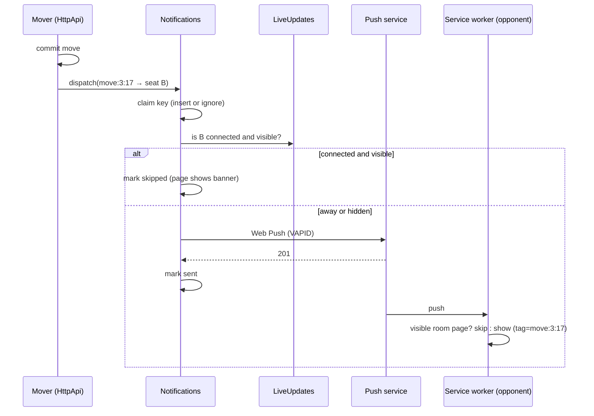
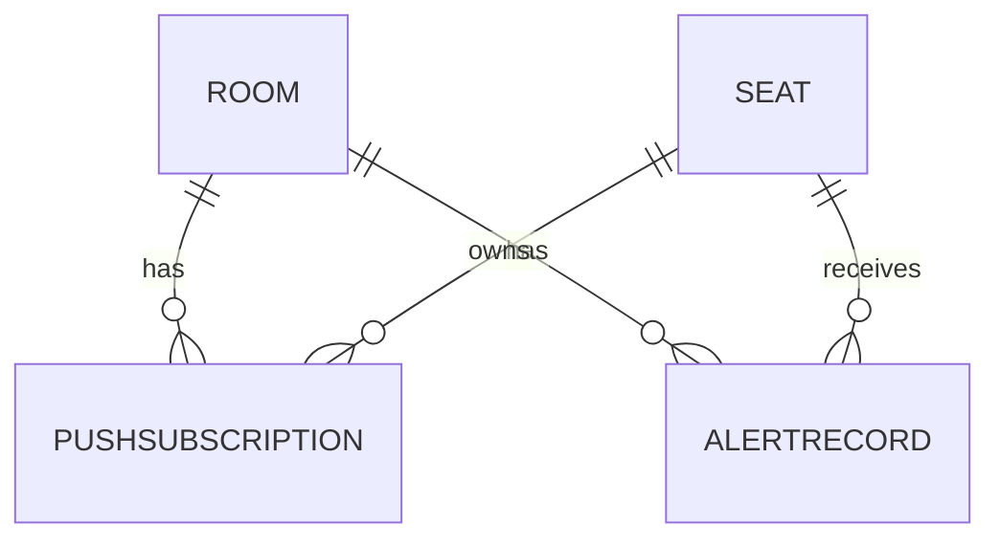

# Functional Specification — u5-notifications

This is the behavioural source of truth for unit U5 (`inception/units-generation/unit-of-work.md`). It covers U5's rows of `inception/units-generation/unit-of-work-story-map.md`: FR6.1–FR6.8, NFR3 and NFR3a, all from `inception/requirements-analysis/requirements.md`. It builds the Notifications component in `inception/domain-design/components.md`, following the one-alert-per-event ADR in `inception/domain-design/decisions.md`. The data is defined in `entities.md` and the decisions in `rules.md`.

## Boundaries and integration points

| With | What U5 uses or adds |
|---|---|
| U1 db | Schema version 3, which adds the `push_subscriptions` and `alert_records` tables. A version-2 database is upgraded in place by creating the two tables in one transaction, so existing rooms are kept. The move-aside rule (BR4.1 in U1) still applies to databases below version 2. |
| U1 api | U5 adds three routes: `GET /api/push/key`, `POST /api/rooms/{code}/push/subscribe` and `POST /api/rooms/{code}/push/unsubscribe`. It also adds `GET /sw.js`, which serves `static/sw.js` with `Service-Worker-Allowed: /` and `Cache-Control: no-cache`. After the join, move, claim-draw and claim-win transactions commit, HttpApi builds the AlertEvent and calls `notifications.dispatch(event)` with `asyncio.to_thread`, outside the room lock. A failure there is logged and never fails the request. |
| U1 live | Uses `hub.is_connected(code, slot)` and `is_visible(code, slot)` (BR1.3). |
| U1 housekeeping | Registers a cleanup hook that deletes by room (BR2.4). |
| U2 settings | `onNotificationsToggle(value) → Promise<boolean>` is implemented by U5 (BR3.1, BR3.4). |
| U3 | `hooks.notifications` is registered at startup. The game screen calls `notify.onSnapshot(prev, next, ctx)` on each applied snapshot for the in-page banner and local notification (BR3.2). Joining or rejoining a room with the setting on re-subscribes for that seat. |
| Dependency | `pywebpush`, added with `uv add pywebpush`. |

## Workflows

### W1 — Turn notifications on (FR6.3, FR6.4, FR6.5)
1. The person turns on "Notifications" in Game settings.
2. Still inside that click, the page asks for permission.
3. If permission is granted:
   1. The page registers `/sw.js` and fetches `/api/push/key`.
   2. When a key comes back, it subscribes to push and posts the subscription for the current seat.
   3. When there is no key, the page works in local-only mode.
4. The setting stays on.
5. If permission is denied, the setting goes back to off and the panel says why.

### W2 — An event happens (FR6.1, FR6.2, FR6.6, FR6.8)
1. A join, move or claim is committed. HttpApi builds the AlertEvent (BR1.1) and hands it to Notifications.
2. Notifications claims the key (BR1.2). An existing key stops here.
3. If the target seat is connected and visible, the claim is marked skipped and the page shows its banner.
4. Otherwise a push is sent to each of the seat's subscriptions and the result is recorded (BR1.4).

### W3 — The push arrives (FR6.4, FR6.5)
1. The service worker receives `{title, body, tag, url, code}`.
2. If a visible page for that room exists, the worker skips the notification.
3. Otherwise it shows the notification, tagged with the event key.
4. Tapping the notification focuses that room's page, or opens it.

### W4 — The page sees the event itself (FR6.3, FR6.4)
1. A snapshot arrives. The page works out the event key the same way as BR1.1.
2. A key shown before is ignored.
3. If the page is visible, it shows the banner: "Your move", "Your opponent has joined" or "Game over — <reason>".
4. If the page is hidden, permission is granted and there is no push subscription, it asks the service worker for a local notification with the same tag.
5. If the page is hidden and a push subscription exists, the page does nothing.

### W5 — Turn notifications off (FR6.7)
1. The page unsubscribes from push and posts unsubscribe.
2. System notifications stop on this device.

### W6 — A subscription has gone stale (FR6.7)
When a send gets 404 or 410, that subscription is deleted, and the next event does not try it again.

## Sequence

<!-- Text fallback: after a move commits, HttpApi hands the event to Notifications, which claims the key once. If the opponent's page is open and visible it marks the alert skipped and lets the page show its banner; otherwise it sends a Web Push, marks it sent when the push service accepts it, and the opponent's service worker shows the notification unless a visible page for the room exists. -->

## Entity relationships (derived from entities.md)

<!-- Text fallback: a room and its seats own push subscriptions and alert records; both go when the room goes. -->

## Rules summary (derived from rules.md)

- **Events and de-duplication:** BR1.1–BR1.4.
- **Subscriptions and keys:** BR2.1–BR2.4.
- **Browser side:** BR3.1–BR3.5.

## Edge cases

| Case | Behaviour |
|---|---|
| The same move is re-sent after a reconnect, or a duplicate request arrives | U1 rejects the stale version, so no second event happens. If an event is dispatched twice, the claim stops the second one. |
| The opponent has two tabs, one visible | The seat counts as visible, so there is no push. The visible tab shows the banner. |
| The opponent has the room's page in a background tab and push is active | A push is sent. The service worker finds no visible page and shows it. The background page does nothing. |
| No VAPID keys | Push is disabled and `/api/push/key` answers 404. Pages fall back to local notifications while the tab is open. |
| A subscription posted for a room that is later deleted | Removed by housekeeping. |
| The push service is slow | The send has a 10 s timeout and runs off the event loop. The move response is not delayed, because dispatch starts after the response is ready. |
| The browser blocks notifications | The setting goes back to off with a message. In-page banners still show. |
| Many endpoints for one seat | Only the 5 newest are kept. |

## Test scope (Standard strategy)

- **Python:**
  - the event builder (join, move, the final move giving "ended" only, claims);
  - the claim never sends twice for one key;
  - the presence rule (connected and visible means skipped; away or hidden means a send);
  - 2xx means sent; 404 and 410 delete the subscription; other errors mean failed;
  - subscribe validation (a non-https endpoint, an IP literal, localhost, bad key lengths, a foreign seat), upsert, and the trim to 5;
  - unsubscribe;
  - VAPID loading (env, file, a file inside the project refused, missing means disabled);
  - `/api/push/key` when enabled and disabled;
  - `/sw.js` headers;
  - schema upgrade from version 2 to 3 keeps the rooms;
  - the housekeeping hook.
- **Node:**
  - the client event-key builder matches the server's for every event;
  - the banner and local-notification decision table (visible, hidden with push, hidden without push, already shown);
  - the toggle flow with fake Notification, serviceWorker and pushManager objects (granted, denied, no key);
  - the service worker's decision logic, extracted as a pure function (visible client means skip).
- **Manual, as recorded in Build and Test:** a real push on localhost in Chromium, with the tab closed.
