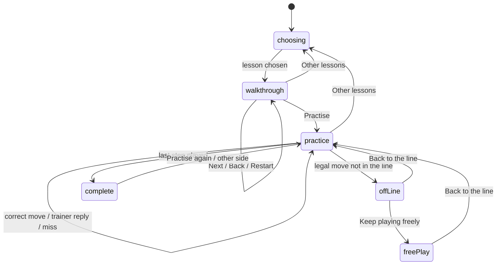
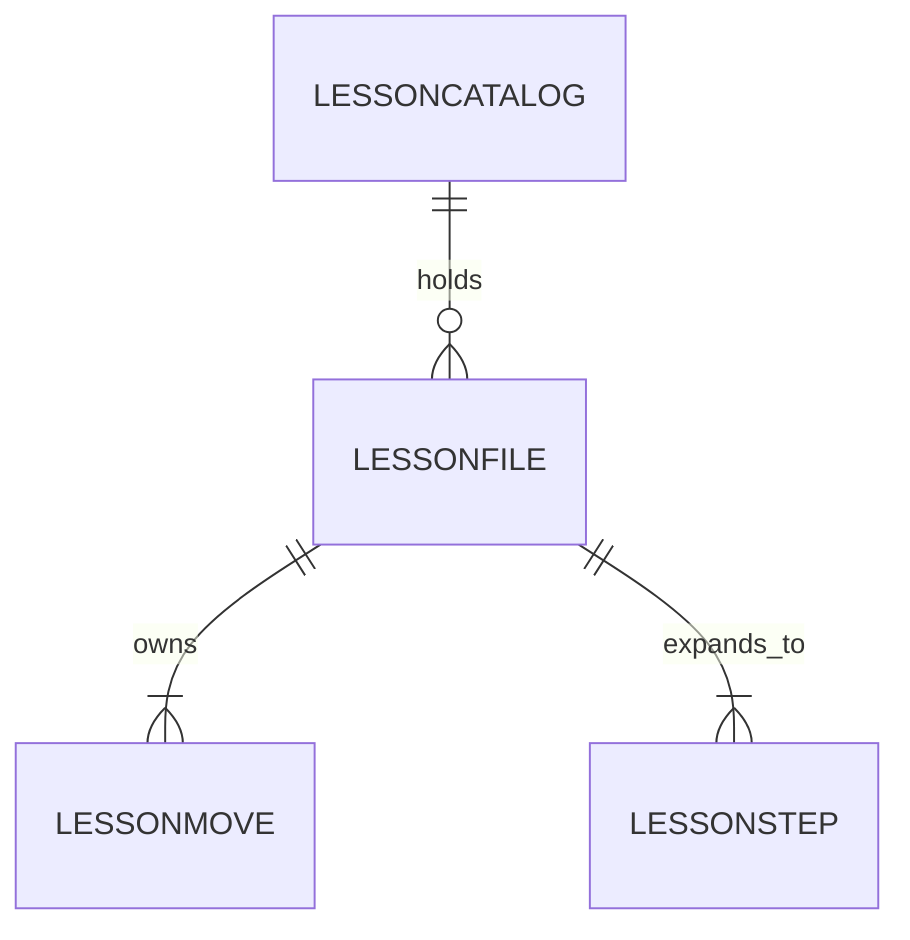

# Functional Specification — u6-training

This is the behavioural source of truth for unit U6 (`inception/units-generation/unit-of-work.md`). It covers U6's rows of `inception/units-generation/unit-of-work-story-map.md`: FR7.1–FR7.7 and FR8.1 from `inception/requirements-analysis/requirements.md`. It uses the Lessons component of `inception/domain-design/components.md`. The data is in `entities.md`, the decisions in `rules.md`, and the screen contracts in `frontend-components.md`. The look follows `inception/refined-mockups/mockups.md` (Training): the same frame and scoresheet, a side switch above the board, notes as margin annotations in book italic, and a dashed arrow after 3 misses.

## Boundaries and integration points

| With | What U6 uses or adds |
|---|---|
| U1 | The `justchess/` package and app factory. U6 adds `justchess/lessons.py` and replaces the inline `LESSONS` dict and the two lesson routes in `api.py`. It also adds `POST /api/position/move`, which uses U1's origin and size middleware. |
| U2 | `createBoard` and the tokens. One additive board option, `onRejectedTap(from, to)`: called when a piece is selected and a non-target square is tapped or chosen by keyboard, so the trainer can say "That move isn't legal." The board's behaviour for every other caller is unchanged. |
| U3 | `hooks.lessonsMount(element, {snapshot})` fills the game drawer. The lobby gets a secondary "Learn an opening" button that goes to `/learn`, and the router gets `/learn` and `/learn/{id}`. The server serves the shell at those paths. |
| Dependency | `pyyaml` is added as a direct dependency. It is already in `uv.lock` as a transitive one. |

## Workflows

### W1 — Load the catalog (FR7.6, FR7.7, BR1.1–BR1.3)
1. At startup the server scans `lessons/`, validates each file, expands the valid ones into steps, and logs one warning per skipped file.
2. On each list or detail request, it compares the folder's file names and modification times to the last scan, and rescans when they differ.
3. A rescan builds a new catalog and replaces the old one in one step, so readers never see half a catalog.

### W2 — Choose a lesson
1. `/learn` lists the lessons with name, ECO and number of moves. In the drawer, the list sits at the top of the drawer.
2. Choosing a lesson loads `/api/lessons/{id}` and opens the walkthrough at move 0.

### W3 — Walkthrough (FR7.1, FR7.2, BR3.1)
1. The board shows the start position, from the lesson side's point of view.
2. Next plays the next step through `board.set({fen: step.fenAfter, lastMove: step.uci})`. That uses U2's slide animation and highlights the move, and the note appears beside its scoresheet row.
3. Back sets the previous `fenAfter` (or the start position) with no animation. Restart goes to move 0.

### W4 — Practice (FR7.3, FR7.4, FR7.5, BR4.1–BR4.5)
1. "Practise" starts at move 0 with the learner on the default side. The side switch, "Practise as White" or "Practise as Black", restarts practice on the other side.
2. On a trainer ply, the scripted move is played after 500 ms.
3. On a learner ply, the board is interactive with `legalMoves = step.legalBefore`.
4. Judge the learner's move (BR4.2):
   - **correct:** play it and show its note, then continue;
   - **illegal** (from `onRejectedTap`): "That move isn't legal.", miss + 1;
   - **legal but off the line:** the board shows the move, then the panel offers "Keep playing freely" and "Back to the line", miss + 1.
5. Hints follow BR4.3. At 3 misses a dashed brass arrow is drawn in an SVG layer over the board, with the SAN and note.
6. At the end, the panel shows "Line complete" with the objectives (BR4.5).

### W5 — Free play (FR7.5, BR4.4)
1. "Keep playing freely" keeps the off-line position.
2. Each move posts `{fen, uci}` to `/api/position/move` and takes the returned `fen` and `legalMoves`. The learner moves both sides.
3. "Back to the line" restores the position before the step the learner left, with the misses kept.

### W6 — Training during a game (BR5.1)
1. Opening the drawer calls the lessons hook once and mounts the trainer with its own board.
2. Game updates keep arriving, and U3's banner still announces "Your move in the game".
3. Closing the drawer keeps the trainer's state. Leaving the room unmounts it.

## Trainer state machine

<!-- Text fallback: the trainer starts by choosing a lesson, then shows the walkthrough. Practise switches to practice, where correct moves, trainer replies and misses keep it in practice. A legal move off the line leads to a choice between going back to the line and free play; free play can also go back to the line. Playing the last step completes the line, from where practice can start again on either side. Other lessons returns to choosing. -->

## Entity relationships (derived from entities.md)

<!-- Text fallback: the catalog holds many lesson files; each file owns its moves and expands into one step per move. -->

## Rules summary (derived from rules.md)

- **Loading:** BR1.1–BR1.4.
- **Routes:** BR2.1–BR2.3.
- **Walkthrough:** BR3.1.
- **Practice:** BR4.1–BR4.5.
- **Mounting:** BR5.1.

## Edge cases

| Case | Behaviour |
|---|---|
| A lesson file is edited while someone is training | Detail requests get the new version. A trainer already open keeps the steps it loaded. |
| Every lesson file is invalid | `/learn` shows "No lessons yet. Add a file to the lessons folder." The server log names each problem. |
| A lesson's start is a FEN with the other side to move | Steps begin with that side, and the trainer handles a first ply that belongs to it. |
| The learner promotes during free play | The board's promotion picker supplies the letter, and `/api/position/move` accepts a five-character UCI. |
| Free play reaches checkmate | The status shows the outcome, and "Back to the line" stays available. |
| The person changes the theme or board while training | The trainer's board follows U2's settings. |

## Test scope (Standard strategy)

- **Python:**
  - the loader: valid files; each kind of bad file skipped with its reason; duplicate ids; JSON and YAML both accepted; steps carry the right FEN and legal moves; reload when the folder changes;
  - the routes: list, detail, 404 with a malformed id, and `/api/position/move` for legal, illegal and invalid FEN;
  - both shipped lessons load and replay fully.
- **Node:**
  - the trainer reducer: the walkthrough indexes; practice judging correct, illegal and off-line; the miss count and the arrow at 3; trainer reply plies; switching side; free play entry and exit; completion;
  - the arrow geometry for both orientations;
  - the board's `onRejectedTap`.
