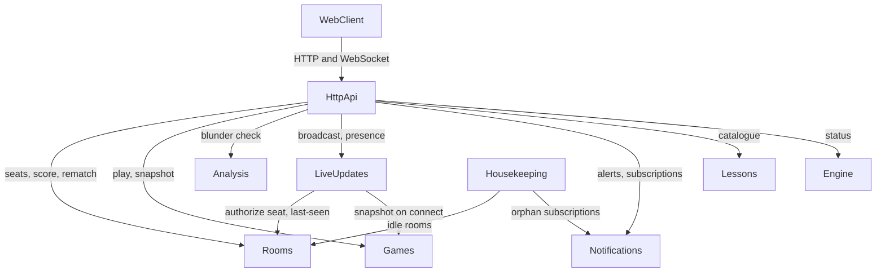

# Components — JustChess P1

The logical building blocks for P1, from `inception/requirements-analysis/requirements.md`. The backend today is one `app.py` holding the Game API, Lesson API, WebSocket broadcast and SQLite access, beside `stockfish_install.py` (code map: `aidlc/spaces/default/codekb/JustChess/architecture.md`, `component-inventory.md`). The frontend is one `app.js`.

The UI parts follow `inception/refined-mockups/interaction-spec.md`. Deployment grouping is decided in Units Generation, not here.

```yaml
components:
  - name: Rooms
    summary: Room codes, the two seats, seat identity and the match score across games
    behaviour: >
      Creates a room with a 6-character code from A-Z and 0-9, using a cryptographic random source and retrying
      on collision. The creator takes seat A; the first joiner takes seat B; a third join is refused.
      Seat tokens have 128+ bits of randomness and are stored only as SHA-256 hashes, compared in constant time.
      Invite links carry only the room code. A continue link carries a separate continue token (also stored
      hashed); opening it moves the seat to the new device by re-issuing the seat token, which invalidates the
      old browser's token. The match score is kept per seat (A wins, B wins, draws), so it follows the player
      when colours swap. A rematch needs both seats to request it; requests lapse when the other seat has been
      away longer than the abandon time (24 h). Joins and seat changes run under a per-room lock.
    responsibilities:
      - Room creation, join by code or link, seat authorization for every action
      - Seat tokens and continue tokens (hashing, verification, rotation)
      - Match score and rematch requests
      - Seat last-seen times, used for abandonment
    depends_on: []
    dependents:
      - component: HttpApi
        interaction: create, join, authorize seats, record results, request rematch
      - component: LiveUpdates
        interaction: check the room exists, authorize a socket's seat, update last-seen
      - component: Housekeeping
        interaction: find and delete rooms idle for 30 days
    external_dependencies:
      - name: SQLite
        kind: database
        purpose: rooms and seats tables
    entities:
      - name: Room
        identifier: code
        attributes: [code, createdAt, lastActivityAt, winsA, winsB, draws, currentGameId, rematchRequestedBy]
      - name: Seat
        identifier: seatId
        attributes: [seatId, roomCode, slot, tokenHash, continueTokenHash, lastSeenAt]
        references:
          - entity: Room
            owned_by: Rooms
            relationship: each Seat belongs to one Room; a Room has at most two Seats (A and B)

  - name: Games
    summary: One game's position, move validation, chess rules, draws and result
    behaviour: >
      Holds one game at a time per room. White in game 1 is seat A, and colours swap on each rematch.
      Validates every move with python-chess against side to move, legality and a game version number;
      a stale or duplicate version is rejected. Ends the game automatically on checkmate, stalemate,
      insufficient material, fivefold repetition and the 75-move rule, recording the reason. Offers a
      draw claim only while threefold repetition or the 50-move rule applies. Supports claiming a win
      when the opponent's seat is abandoned (the caller passes that fact in). Produces the snapshot:
      position, legal moves, check, turn, status, reason, numbered move list and version.
    responsibilities:
      - Game state, move list, version number
      - Rules, terminal conditions with reasons, draw claims, abandonment wins
      - Snapshot for clients
    depends_on: []
    dependents:
      - component: HttpApi
        interaction: start game, apply move, claim draw, claim win, read snapshot
      - component: LiveUpdates
        interaction: read snapshot on connect
    external_dependencies:
      - name: python-chess
        kind: other
        purpose: authoritative chess rules
      - name: SQLite
        kind: database
        purpose: games and moves tables
    entities:
      - name: Game
        identifier: gameId
        attributes: [gameId, roomCode, number, whiteSlot, fen, version, status, endReason, result, startedAt, endedAt]
        references:
          - entity: Room
            owned_by: Rooms
            relationship: each Game is played in one Room; a Room has one current Game and earlier ones
      - name: Move
        identifier: gameId+ply
        attributes: [gameId, ply, uci, san, playedAt]

  - name: Analysis
    summary: Answers "what does this move allow?" for blunder warnings, the home of future engine features
    behaviour: >
      Given a position and a candidate move, reports one of three things: mate-in-one allowed (with the mating
      move), a non-pawn piece left capturable without loss (with piece, square and capturer), or nothing.
      It warns only when the move itself creates the problem: a piece that was already hanging does not
      re-trigger. It returns nothing when every legal move has the same problem. The check is pure and works on
      the position the caller passes, so the warning and the move use the same game version. P1 uses
      python-chess only; Stockfish is not used.
    responsibilities:
      - Mate-in-one detection
      - Hanging-piece detection with the "creates the problem" and "no alternative" rules
    depends_on: []
    dependents:
      - component: HttpApi
        interaction: blunder check before a move is sent
    external_dependencies:
      - name: python-chess
        kind: other
        purpose: move generation and attack maps
    entities: []

  - name: Engine
    summary: Makes the pinned Stockfish binary available and reports its status (the existing stockfish_install.py)
    behaviour: >
      At startup, finds or installs the pinned, checksum-verified Stockfish in the background. The app starts
      without it on any failure. Reports availability without exposing the path. Unchanged in P1.
    responsibilities:
      - Engine install and status
    depends_on: []
    dependents:
      - component: HttpApi
        interaction: engine status endpoint, startup hook
    external_dependencies:
      - name: GitHub releases (Stockfish sf_19)
        kind: third-party-api
        purpose: download of the pinned binary
    entities: []

  - name: LiveUpdates
    summary: WebSocket connections per room, broadcast of snapshots, and presence
    behaviour: >
      Accepts a socket for an existing room only, checking the request's Origin. Identifies the seat from the
      token sent in the first message (never in the URL). Sends the full snapshot on connect. Broadcasts a
      snapshot after every change. Tracks which seats are connected and whether their page is visible (the
      client reports visibility), updates the seat's last-seen time, and reports a disconnect within 10 seconds
      through a heartbeat.
    responsibilities:
      - Socket lifecycle, broadcast, heartbeat
      - Presence (connected, visible) per seat
    depends_on:
      - component: Rooms
        interaction: check the room exists, authorize the seat, update last-seen
        style: sync
      - component: Games
        interaction: read snapshot to send on connect
        style: sync
    dependents:
      - component: HttpApi
        interaction: broadcast after changes, read presence to decide notifications
    external_dependencies: []
    entities: []

  - name: Notifications
    summary: Push subscriptions, Web Push delivery and the one-alert-per-event rule
    behaviour: >
      Stores the minimal push subscription per seat (endpoint and keys). Sends Web Push signed with VAPID keys
      that are loaded from environment variables or a key file outside the repo; push is disabled, with a log
      line, when the keys are missing. Before sending, records an alert key (seat plus event, for example move
      number or "joined" or "ended"). An existing key means no second alert. Sends push only when the target seat
      is not connected or not visible. Deletes subscriptions the push service reports as gone (404 or 410).
      A seat can turn notifications off, which deletes its subscriptions.
    responsibilities:
      - Subscription storage and cleanup
      - Server-side de-duplication of alerts
      - Web Push sending
    depends_on: []
    dependents:
      - component: HttpApi
        interaction: subscribe, unsubscribe, notify on join, move and game end
      - component: Housekeeping
        interaction: delete subscriptions of deleted rooms
    external_dependencies:
      - name: Browser push services (FCM, Mozilla, Apple)
        kind: third-party-api
        purpose: Web Push delivery
      - name: SQLite
        kind: database
        purpose: push subscriptions and sent-alert records
    entities:
      - name: PushSubscription
        identifier: subscriptionId
        attributes: [subscriptionId, seatId, endpoint, p256dh, auth, createdAt, lastUsedAt]
        references:
          - entity: Seat
            owned_by: Rooms
            relationship: each subscription belongs to one Seat
      - name: AlertRecord
        identifier: seatId+eventKey
        attributes: [seatId, eventKey, sentAt]
        references:
          - entity: Seat
            owned_by: Rooms
            relationship: each record is for one Seat

  - name: Lessons
    summary: Opening lessons loaded from YAML/JSON files, with per-step positions and legal moves for training
    behaviour: >
      Loads every lesson file at startup and validates the required fields and that every move is legal; an
      invalid file is reported with its name and skipped, and the others still load. Expands a lesson into steps:
      SAN, UCI, note, position before, and the legal moves in that position. That lets the client tell an
      illegal move from a legal move off the taught line without a chess library. Gives the lesson's default
      side.
    responsibilities:
      - Lesson file loading and validation
      - Lesson catalogue and step expansion
    depends_on: []
    dependents:
      - component: HttpApi
        interaction: list lessons, get a lesson
    external_dependencies:
      - name: Lesson files (lessons/*.yaml or *.json)
        kind: other
        purpose: version-controlled lesson content
      - name: python-chess
        kind: other
        purpose: move validation and legal-move lists
    entities:
      - name: Lesson
        identifier: lessonId
        attributes: [lessonId, name, aliases, eco, defaultSide, startFen, moves, notes, alternatives, objectives]

  - name: Housekeeping
    summary: Scheduled cleanup of idle rooms and their data
    behaviour: >
      Runs at startup and then hourly. Deletes rooms whose last activity is more than 30 days ago, together with
      their seats, games, moves, subscriptions and alert records. Never deletes an active room.
    responsibilities:
      - Retention (30 days)
    depends_on:
      - component: Rooms
        interaction: find and delete idle rooms
        style: sync
      - component: Notifications
        interaction: delete subscriptions and alert records for deleted rooms
        style: sync
    dependents: []
    external_dependencies: []
    entities: []

  - name: HttpApi
    summary: HTTP routes, page and asset serving, origin checks, and the orchestration of cross-component flows
    behaviour: >
      Serves the page, static assets (fonts, SVG pieces, ES modules) and the service worker at the site root.
      Checks the Origin header on every state-changing request and bounds request sizes. Validates inputs.
      Orchestrates each use case, so components never call each other in cycles. A move goes: Rooms authorizes
      the seat, then Games applies the move, then on game end Rooms records the result, then LiveUpdates
      broadcasts, then Notifications alerts the opponent when they are away. On upgrade, a database without the
      new schema is replaced with a fresh one; old rooms are not kept.
    responsibilities:
      - Routes and request validation
      - Use-case orchestration
      - Origin checks
      - Static and service-worker serving
      - Fresh-schema start
    depends_on:
      - component: Rooms
        interaction: rooms, seats, score, rematch
        style: sync
      - component: Games
        interaction: game play and snapshots
        style: sync
      - component: Analysis
        interaction: blunder check
        style: sync
      - component: LiveUpdates
        interaction: broadcast, presence
        style: sync
      - component: Notifications
        interaction: subscriptions and alerts
        style: sync
      - component: Lessons
        interaction: lesson catalogue
        style: sync
      - component: Engine
        interaction: status and startup
        style: sync
    dependents:
      - component: WebClient
        interaction: all HTTP and WebSocket calls
    external_dependencies:
      - name: FastAPI / Uvicorn
        kind: other
        purpose: web framework and server
    entities: []

  - name: WebClient
    summary: The browser app, as native ES modules (lobby, game, board, training, notifications, settings) plus the service worker
    behaviour: >
      Renders the redesigned UI from the design tokens.
      - Board module: the board with orientation, labels, themes, SVG pieces, keyboard play and motion, honouring
        reduced motion.
      - Game module: the game screen, scoresheet, status, blunder dialog, promotion picker, end-of-game overlay,
        rematch, share and continue link.
      - Lobby module: create and join, including join by link.
      - Training module: walkthrough and practice with the side switch, hints after 3 misses and the off-line
        choice.
      - Notifications module: permission after a user action, the in-page banner, push subscription, and visibility
        reports.
      - Settings module: device settings and the saved seat, with a notice when storage is blocked.
      - Service worker: shows push notifications with one tag per event, skips them when the room's page is
        visible, and opens the game on tap.
    responsibilities:
      - All UI, interaction and motion
      - Device settings and saved seat
      - Service worker for push
    depends_on:
      - component: HttpApi
        interaction: HTTP JSON API and WebSocket
        style: sync
    dependents: []
    external_dependencies:
      - name: Browser storage, Web Share, Notifications, Push API
        kind: other
        purpose: device features
    entities:
      - name: DeviceSettings
        identifier: storageKey
        attributes: [storageKey, theme, boardTheme, labels, blunderWarnings, notificationsOn]
      - name: SavedSeat
        identifier: roomCode
        attributes: [roomCode, seatToken, slot]
        references:
          - entity: Seat
            owned_by: Rooms
            relationship: a SavedSeat holds the browser's copy of one Seat's token
```

## Component Diagram


<!-- Text fallback: WebClient calls HttpApi. HttpApi calls Rooms, Games, Analysis, LiveUpdates, Notifications, Lessons and Engine. LiveUpdates calls Rooms and Games. Housekeeping calls Rooms and Notifications. No cycles. -->

## Component Summary

| Component | Purpose | Depends On | Dependents | Entities Owned |
|---|---|---|---|---|
| Rooms | Codes, seats, seat identity, match score, rematch | — | HttpApi, LiveUpdates, Housekeeping | Room, Seat |
| Games | One game's rules, moves, draws, result | — | HttpApi, LiveUpdates | Game, Move |
| Analysis | Blunder detection | — | HttpApi | — |
| Engine | Stockfish install and status | — | HttpApi | — |
| LiveUpdates | Sockets, broadcast, presence | Rooms, Games | HttpApi | — |
| Notifications | Push subscriptions, de-duplication, delivery | — | HttpApi, Housekeeping | PushSubscription, AlertRecord |
| Lessons | Lesson files and steps | — | HttpApi | Lesson |
| Housekeeping | 30-day retention | Rooms, Notifications | — | — |
| HttpApi | Routes, origin checks, orchestration | Rooms, Games, Analysis, LiveUpdates, Notifications, Lessons, Engine | WebClient | — |
| WebClient | Browser UI and service worker | HttpApi | — | DeviceSettings, SavedSeat |

## Entity Ownership

| Entity | Owning Component | Identifier | Attributes | References |
|---|---|---|---|---|
| Room | Rooms | code | createdAt, lastActivityAt, winsA, winsB, draws, currentGameId, rematchRequestedBy | — |
| Seat | Rooms | seatId | roomCode, slot, tokenHash, continueTokenHash, lastSeenAt | Room |
| Game | Games | gameId | roomCode, number, whiteSlot, fen, version, status, endReason, result, startedAt, endedAt | Room |
| Move | Games | gameId+ply | uci, san, playedAt | — |
| PushSubscription | Notifications | subscriptionId | seatId, endpoint, p256dh, auth, createdAt, lastUsedAt | Seat |
| AlertRecord | Notifications | seatId+eventKey | sentAt | Seat |
| Lesson | Lessons | lessonId | name, aliases, eco, defaultSide, startFen, moves, notes, alternatives, objectives | — |
| DeviceSettings | WebClient | storageKey | theme, boardTheme, labels, blunderWarnings, notificationsOn | — |
| SavedSeat | WebClient | roomCode | seatToken, slot | Seat |

## External Dependencies

| Component | Dependency | Kind | Purpose |
|---|---|---|---|
| Rooms, Games, Notifications | SQLite | database | Persistence |
| Games, Analysis, Lessons | python-chess | other | Chess rules |
| Engine | GitHub releases (Stockfish sf_19) | third-party-api | Binary download |
| Notifications | Browser push services | third-party-api | Web Push delivery |
| Lessons | Lesson files | other | Lesson content |
| HttpApi | FastAPI / Uvicorn | other | Web framework |
| WebClient | Browser storage, Web Share, Notifications, Push API | other | Device features |

## Rationale

| Component | Why a separate building block |
|---|---|
| Rooms | Owns identity and security (seat tokens), and its lifetime is the room's, across many games (ADR-001) |
| Games | Pure chess rules for one game; changes for rule reasons, not seat or score reasons (ADR-001) |
| Analysis | A distinct question ("what does this move allow?") and the future engine's home; testable alone (ADR-002) |
| Engine | Already separate; it handles the system and network, not chess |
| LiveUpdates | In-memory connection state with its own lifecycle; the place to swap to Redis pub/sub when scaling (spec constraint) |
| Notifications | Owns external push delivery, secrets (VAPID) and the one-alert rule (ADR-005) |
| Lessons | Content from files with its own validation; changes when content changes |
| Housekeeping | Scheduled work, separate from request handling |
| HttpApi | Keeps the components free of each other by orchestrating every flow (ADR-003) |
| WebClient | The browser tier: all UI, as ES modules (ADR-004) |

**Alternatives rejected:**
- One Game component holding seats and score (Q1 option B; see ADR-001).
- Blunder checks inside Games (Q2; see ADR-002).
- Components calling each other directly, with Games notifying Rooms of results. That creates a Rooms↔Games cycle (ADR-003).
