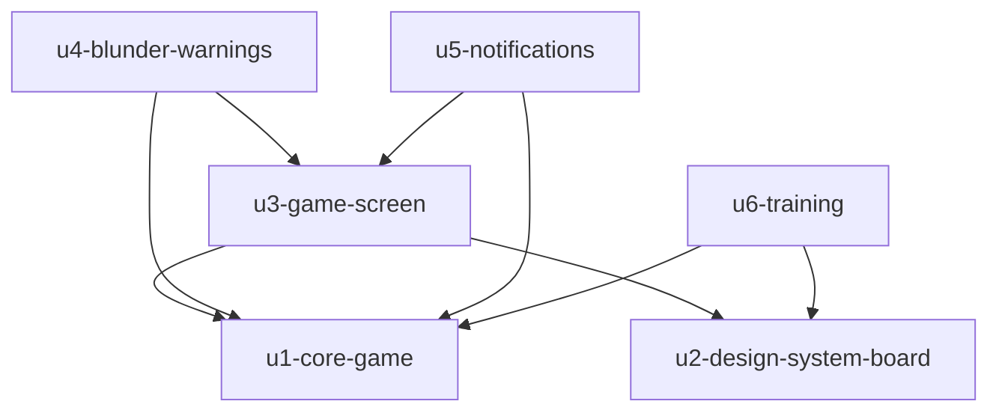

# Unit Dependencies — JustChess P1

Topology only: what depends on what. It is drawn from `unit-of-work.md`, the components in `inception/domain-design/components.md` and the decisions in `inception/domain-design/decisions.md`, and it covers `inception/requirements-analysis/requirements.md`. Construction builds one unit at a time in an order that respects these edges.

## Edges

- **u3-game-screen depends on u1-core-game.** It calls the new API: snapshot fields, seats, continue link, claims, rematch.
- **u3-game-screen depends on u2-design-system-board.** It renders through the board module, tokens and settings.
- **u4-blunder-warnings depends on u1-core-game.** The check-move route uses Rooms seat checks and Games versions.
- **u4-blunder-warnings depends on u3-game-screen.** The dialog lives in the game screen's move flow.
- **u5-notifications depends on u1-core-game.** It needs the join, move and end hooks in HttpApi, presence from LiveUpdates, and Seat identity.
- **u5-notifications depends on u3-game-screen.** The banner, the permission button and visibility reports live in the game screen.
- **u6-training depends on u1-core-game.** It uses the `justchess/` package structure and the API module for its routes.
- **u6-training depends on u2-design-system-board.** It uses the board module (animation, highlights, arrows).


<!-- Text fallback: u1 and u2 depend on nothing. u3 depends on u1 and u2. u4 and u5 each depend on u1 and u3. u6 depends on u1 and u2. There is no cycle. -->

## Integration points

| From | To | Integration |
|---|---|---|
| u3 | u1 | HTTP JSON API and the WebSocket snapshot (extends today's fields; the old field names are kept during U1) |
| u3 | u2 | ES module imports: `board.js`, `settings.js`, `tokens.css` |
| u4 | u1 | Server-side: Analysis is called by a new HttpApi route that uses Rooms and Games |
| u4 | u3 | The client calls `check-move` before sending a move; the dialog is mounted in the game module |
| u5 | u1 | HttpApi calls Notifications on join, move and end; presence comes from LiveUpdates |
| u5 | u3 | The notifications module hooks into the game module (banner, visibility) |
| u6 | u1 | Lesson routes are added to the API package |
| u6 | u2 | The board module renders lessons |
| u6 | u3 (soft) | Training mounts in u3's lessons drawer when u3 is present; otherwise it has its own route. There is no build or test dependency |

## Parallel development opportunities

- u1 and u2 have no edge between them and can be built side by side.
- u4 and u5 have no edge between them.
- u6 has no edge to u3, u4 or u5.

Each unit's code and tests pass with its own code, the units it depends on, and the project as it stands.

## Walking skeleton

Not applicable: this plan has the walking-skeleton ceremony switched off.

```yaml
units:
  - name: u1-core-game
    kind: service
    depends_on: []
  - name: u2-design-system-board
    kind: ui
    depends_on: []
  - name: u3-game-screen
    kind: ui
    depends_on: [u1-core-game, u2-design-system-board]
  - name: u4-blunder-warnings
    kind: service
    depends_on: [u1-core-game, u3-game-screen]
  - name: u5-notifications
    kind: service
    depends_on: [u1-core-game, u3-game-screen]
  - name: u6-training
    kind: ui
    depends_on: [u1-core-game, u2-design-system-board]
```
