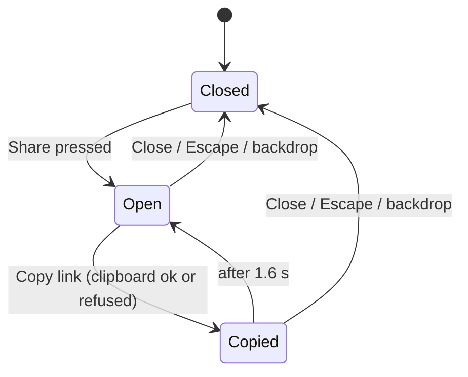
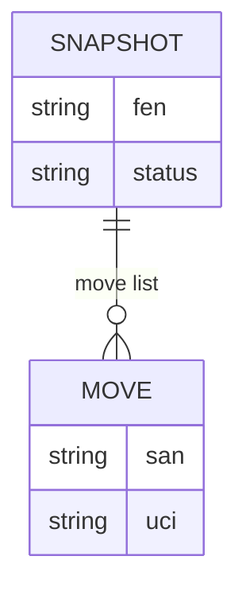

# Functional Specification — u1-game-screen-polish

U1 is a front-end-only unit (kind `ui`). It extends the existing board, game screen and share code from intent 261112 (`static/js/board/`, `static/js/screens/game.js`, `static/js/share.js`, `static/css/`). There are no server, API or data changes. The rules are in `rules.md`, and the components in `frontend-components.md`.

Inputs: requirements FR2.1–FR2.3, FR4.1–FR4.3, FR5.1–FR5.5, NFR2, NFR3, NFR5; mockups Screens 3 and 4; interaction spec (CaptureAnimation, BoardFit, ShareDialog).

## Workflow W1: a capture happens (FR2)

1. A new position reaches the board: a received live update, the player's own move shown optimistically, or a replayed move.
2. The board compares the previous and the new position with the last move. The existing `diffMove` already finds the taken piece and its square, including the en passant square.
3. If reduced motion is set, skip to step 6 (BR1.4).
4. The board adds an animated copy of the taken piece on its square. The copy shrinks to 35 % and fades out over 260 ms. It ignores pointer events (BR1.3, BR1.5).
5. The moving piece slides at the same time (existing 200 ms slide).
6. When the copy ends, it is removed. The game screen's captured row updates from the move list (BR1.6). The newly added piece fades in over 200 ms, or appears at once under reduced motion.

**Own move (BR1.2):**
- When the player makes a capture, the board shows it at once (optimistic) and runs W1 from step 2.
- When the server confirms the same move, the confirmation renders without a second capture animation. The new position matches what is already shown, so the diff finds no change.
- If the server rejects the move, the board slides the piece back and restores the taken piece without a capture animation (existing `slideBack` path).

**Interrupted animation (BR1.5):** a new position, or a new move by the player, finishes running animations at once (existing `finishAnimations`) before it is drawn.

## Workflow W2: the board fits the screen (FR4)

1. On load, and on every resize or orientation change, the layout picks one of three modes (BR2.1–BR2.3):

   | Mode (checked in this order) | Condition | Layout |
   |---|---|---|
   | landscape-phone | landscape and height ≤ 500 | board left, compact top bar, panel right |
   | desktop | width ≥ 1024 | board left, panel right; side capped at 640 px |
   | portrait | otherwise | board above, panel below |

   The 7 sizes from FR4.1 with their expected mode and board side, at the default font size:

   | Size | Mode | Board side (px) | Square (px) |
   |---|---|---|---|
   | 360 × 640 | portrait, edge to edge | 360 | 45 |
   | 390 × 844 | portrait, edge to edge | 390 | 48.75 |
   | 768 × 600 | portrait | 448 (600 − 152) | 56 |
   | 768 × 1024 | portrait | 736 (768 − 32 gutter) | 92 |
   | 1280 × 720 | desktop | 610 (720 − 110) | 76.25 |
   | 640 × 360 | landscape-phone | 336 (360 − 24) | 42 |
   | 844 × 390 | landscape-phone | 366 (390 − 24) | 45.75 |

2. The board side is computed by CSS from the viewport (`min()` of width and `100svh` minus the reserved heights). No script measures it, except the existing piece-size custom property that follows the board's width.
3. The floor of BR2.4 is applied: 352 px in portrait and desktop, 288 px (8 × 36) in landscape-phone.
4. The panel content below or beside the board scrolls normally (BR2.5).

The reserved heights:

| Mode | Reserved |
|---|---|
| portrait | top bar 56 px, status line 64 px, gaps 32 px |
| desktop | top bar 56 px, gaps 54 px |
| landscape-phone | 24 px total, with the top bar folded into the panel |

The browser test measures the result at the 7 sizes of FR4.1.

## Workflow W3: share the game (FR5)

1. The player presses Share in the top bar.
2. The share dialog opens as a native modal (BR3.1). Its text depends on the room state (BR3.6).
3. Focus moves to "Copy link" (BR3.5).
4. The QR code of the invite link is drawn on a canvas (BR3.4). The encoder module loads only when the dialog first opens.
5. The player either:
   - presses **Copy link**: copied, and the label shows "Copied" for 1.6 s (BR3.2);
   - presses **Email, WhatsApp, Telegram or SMS**: the link opens that app with the text filled in (BR3.3). The dialog stays open;
   - presses **More…**, shown only when the browser has a share sheet: the share sheet opens. A cancel does nothing;
   - closes with **Close, Escape or a click on the backdrop**: focus returns to Share (BR3.5).

### Dialog states

Text fallback: Closed goes to Open when Share is pressed. Open goes to Copied on Copy link, and back to Open after 1.6 s. Close, Escape or the backdrop return to Closed from either state.

## Error and edge cases

| Case | Behaviour |
|---|---|
| The browser has no Web Animations | No capture animation; the piece disappears as before; the captured row still updates |
| Two captures arrive in quick succession (fast live updates) | The first animation is finished at once, then the second plays |
| Promotion with capture | The taken piece animates; the promoted piece slides in as the new piece |
| Clipboard refused (permission or older browser) | The link text is selected and the label reads "Copied" (BR3.2) |
| No share sheet | "More…" is hidden (BR3.3) |
| QR encoder fails to load (network blip on first open) | The QR area shows "QR code unavailable" and the rest of the dialog works; the error is logged to the console |
| Very long invite link (custom origin) | QR level M fits URLs up to about 200 characters; the input scrolls |
| Narrow phone (320 px) | Below the 352 px floor, the board keeps 352 px and the page scrolls sideways. This size is outside FR4.1's minimum (360 px); recorded as accepted |
| Screen reader | The capture is announced by the existing move announcement ("Bishop takes f7"), and the captured row's label updates (BR1.6) |

## Rules summary (derived from `rules.md`)

| Group | Rules |
|---|---|
| Capture animation | BR1.1–BR1.6 |
| Board fit | BR2.1–BR2.5 |
| Share dialog | BR3.1–BR3.6 |

## Entity view

U1 has no persistent entities. The only data it reads are the existing position, move list and room state from the game snapshot.

Text fallback: one game snapshot carries many moves. The captured row is derived from them.

## Tests (test-after, Standard strategy)

- **JS unit tests (`node --test`):**
  - `capturedPieces(moves)` for normal captures, en passant, promotion with capture, and no captures.
  - The board-mode chooser for each of the 7 FR4.1 sizes, plus 320 px.
  - The share link builder: encoding of `&`, `#` and spaces, and every app's URL shape.
  - The QR encoder: a known input matches a reference matrix.
  - The dialog text for waiting and joined rooms.
- **Browser tests (headless Chromium, existing CDP harness):**
  - At each FR4.1 size the board's bottom edge is within the viewport at scroll 0, and squares meet the floor.
  - A capture creates an animated copy on the right square, and none under emulated reduced motion.
  - The dialog: focus starts on Copy link, Tab stays inside, Escape closes, focus returns to Share, and the game screen DOM is unchanged.
- The existing suite stays green, including P1's 44 px accessibility test.

## Sources
- `inception/requirements-analysis/requirements.md` FR2, FR4, FR5, NFR2, NFR3, NFR4, NFR5
- `inception/refined-mockups/mockups.md` Screens 3 and 4; `interaction-spec.md`
- `inception/units-generation/unit-of-work.md` U1
- `inception/domain-design/decisions.md` ADR-008
