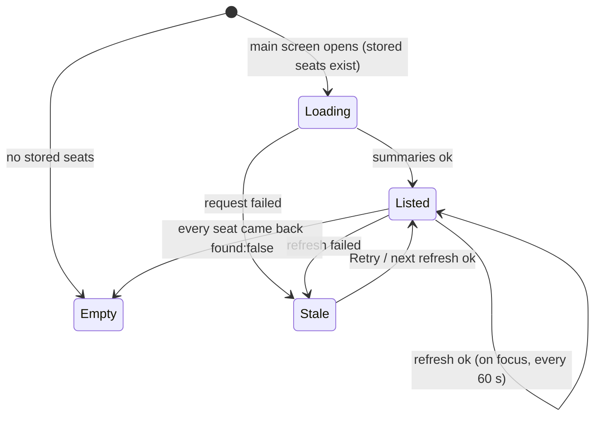
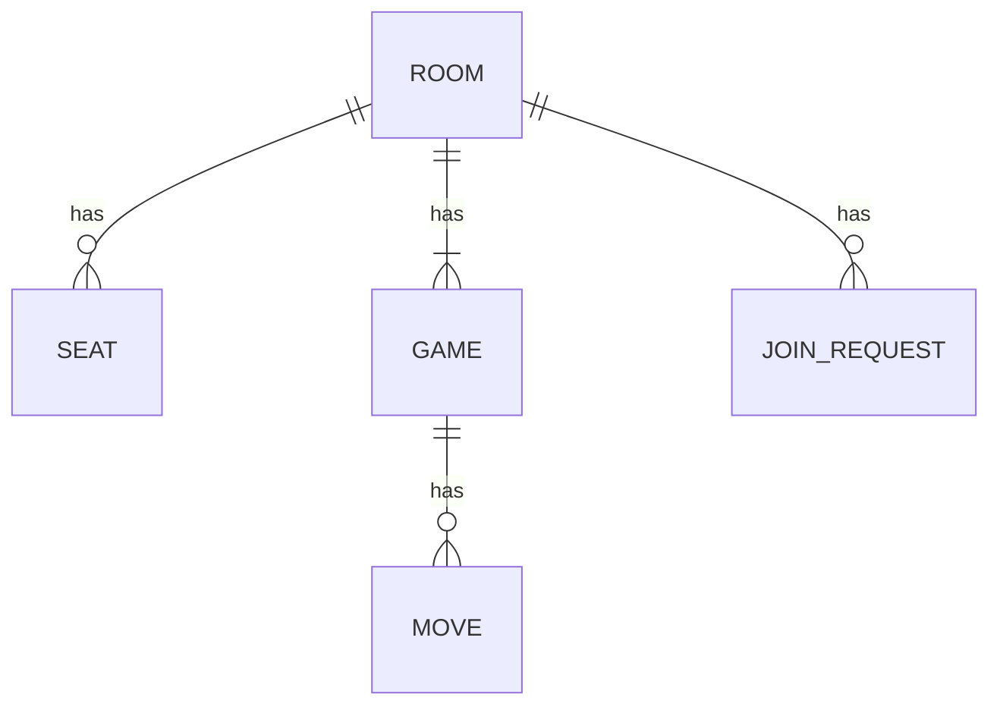

# Functional Specification — u2-data-and-your-games

U2 lays the data foundation for U3 and U4 and builds the "Your games" list. Entities are in `entities.md`, rules in `rules.md`. Inputs:
- requirements FR1.1–FR1.5 and FR2.1 (capture info), NFR4 and NFR7;
- ADR-010 (fresh version-4 schema);
- mockups Screen 1;
- interaction spec, YourGamesList.

## W1 Start-up (BR1.1)
1. `prepare_database(path)` reads the schema version.
2. If the version is 4, it opens the file.
3. If the file is missing, it creates the schema.
4. Otherwise (version 1–3, unmarked, or not SQLite), it renames the file to `<name>.old`, replacing an earlier one, then creates the schema.
5. It logs one line saying which of these happened. It never logs paths of secrets or the contents of the file.

The version-2 upgrade path (`UPGRADABLE_VERSION`, `_upgrade_in_place`) and its tests are removed, and replaced by tests for the move-aside path at versions 2 and 3.

## W2 Moves record captures (BR1.3)
1. The existing apply-move path validates the move with python-chess.
2. Before pushing it, the path computes the captured piece and square: the en passant square for en passant, otherwise the arrival square.
3. The move row stores them.
4. The snapshot gains `lastCapture: {piece, square} | null` for the last move. Its existing fields are unchanged.

## W3 Friend room modes (BR1.2)
1. Creating a room inserts it with mode `waiting`.
2. A successful join sets mode `online` in the same transaction.
3. The snapshot gains `mode` and `computerLevel`, which is null for friend rooms.

## W4 Batch summaries (BR2.1–BR2.3)

Request: `POST /api/rooms/summaries`, body `{ "seats": [ { "code": "K7Q2PX", "token": "…" } ] }`.

1. Validate the body (1–50 entries, code format, token length). The origin check and the 8 KB size limit apply.
2. Open one read connection. For each distinct code, load the room, find the seat whose token hash matches (constant-time comparison), load its current game and any pending join request.
3. Answer `{ "rooms": [ RoomSummary … ] }`, in request order, deduplicated.
4. Nothing is written.

| Case | Answer |
|---|---|
| Unknown code | `{code, found:false}` |
| Wrong token for a real room | `{code, found:false}`, so the room's existence is not revealed |
| The computer's seat | Has no token, so it can never match |
| Malformed body | 400 `{error:"bad_request", detail}` |
| Body too large | 413 |
| Bad origin | 403 (existing check) |

## W5 Your games list (BR3.1–BR3.5)

Text fallback:
- **Loading**: shown while the first request runs. It moves to Listed on success and to Stale on failure.
- **Listed**: refreshes on focus and every 60 s while visible. A failed refresh goes to Stale.
- **Stale**: keeps the rows and shows "Couldn't refresh your games. Retry".
- **Empty**: shown when there are no stored seats, or when every seat came back `found:false`.

1. Read the stored seats from the seat store. With none, show Empty.
2. Send W4 with every stored seat.
3. Drop seats that came back `found:false` (BR3.3).
4. Filter and sort (BR3.1) and render the rows (BR3.2). Each row is a link to `/r/<code>`.
5. On a refresh, re-render in place, keeping focus on the same row if it still exists.

**Layout:** two columns at 900 px wide and above (actions on the left, the list on the right). Below that, the list sits under the actions.

## W6 Main screen copy (BR3.6)
- The headline becomes "Play a friend. Play the computer. Get better."
- "Learn an opening" becomes "Train" and opens `/learn`.
- "Play the computer" is added by U4, not here.

## Entity view (derived from `entities.md`)

Text fallback: a room has up to two seats, one or more games, and any number of join requests. A game has many moves.

## Rules summary (derived)

| Group | Rules |
|---|---|
| Data | BR1.1–BR1.3 |
| Summaries API | BR2.1–BR2.3 |
| Your games list | BR3.1–BR3.6 |

## Error and edge cases

| Case | Behaviour |
|---|---|
| Seat store blocked (private mode) | The list shows Empty; the existing notice about blocked storage stays |
| More than 50 stored seats | Only the 50 most recently saved are sent; older ones stay stored until they age out |
| A room deleted by housekeeping (30 days idle) | `found:false`, so the seat is dropped |
| Every found game is older than 7 days | Shown as Empty ("No games yet…") |
| First request fails with no earlier data | Stale rows show the room code and, for computer rooms, the level, with a "Couldn't refresh" pill |
| Summary request rate | The client sends at most one request per 30 s (except Retry); the route is read-only and capped at 50 entries |
| Clock skew between browser and server | Relative times use the server's `lastActivityAt` against the browser's clock; the 7-day filter uses the server's `endedAt` |
| Old database at first start after U2 | Moved to `.old`; every stored seat comes back `found:false` and drops off the list (accepted, ADR-010) |

## Tests (test-after, Standard)

- **Python:**
  - `tests/test_db.py`: fresh v4 created; v2 and v3 moved aside; garbage file moved aside; the v4 file kept as is; computer-seat constraint.
  - `tests/test_games.py`: capture info for a normal capture, en passant, promotion with capture, and a quiet move; `lastCapture` in the snapshot.
  - `tests/test_rooms.py`: mode waiting, then online on join.
  - `tests/test_summaries.py`:
    - ok and `found:false` for both an unknown room and a wrong token;
    - your turn, result as won, lost and drawn;
    - pending join request (row inserted directly);
    - 400, 413 and 403;
    - read-only (last activity unchanged);
    - no token in captured logs.
- **JS:** `tests/js/your-games.test.mjs`: filtering and sorting, the 7-day cut-off, the join-request pill first, labels and pills, seat dropping only on `found:false`, the failure path keeping seats.
- **Browser:** one test. Two rooms are created, the main screen lists both, and the row with "Your move" opens its game.
- **Existing tests:** the version-2 upgrade tests (`tests/test_notifications_db.py` or wherever they sit) are replaced by move-aside tests. The rest of the suite stays green.

## Sources
- `inception/requirements-analysis/requirements.md` FR1, FR2.1, NFR4, NFR7
- `inception/domain-design/decisions.md` ADR-002, ADR-003, ADR-005, ADR-010
- `inception/refined-mockups/mockups.md` Screen 1; `interaction-spec.md`
- `inception/units-generation/unit-of-work.md` U2
