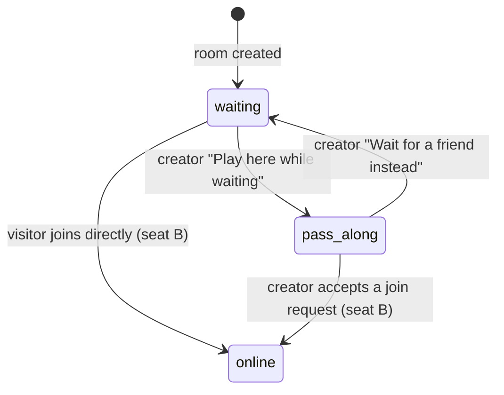
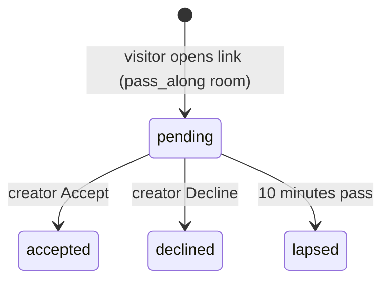
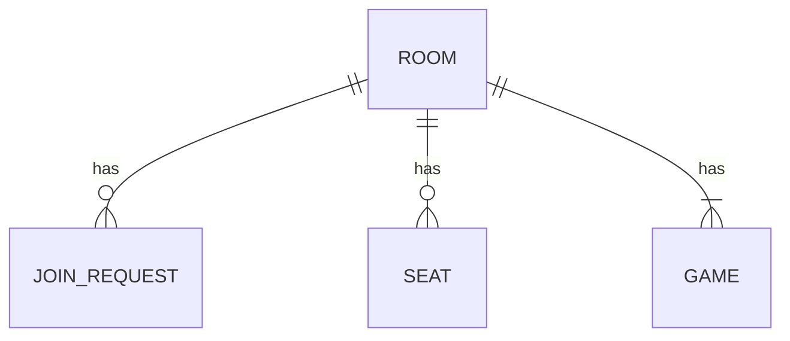

# Functional Specification — u3-pass-along

U3 adds pass-along play while waiting and the join-request handshake. Entities are in `entities.md` and rules in `rules.md`. Inputs:
- requirements FR3.1–FR3.9, FR9.1, FR9.2 and NFR4;
- ADR-003 and ADR-006;
- mockups Screens 5–6;
- the interaction spec sections PassAlong and JoinRequest;
- U2's schema version 4 and summaries.

**Deviation from Domain Design.** The joiner learns the answer by polling (BR2.3), not over a request-scoped WebSocket. It is simpler, needs no new socket authentication mode, and survives reloads and server restarts. It still meets FR3.3–FR3.6. Accepting reuses the joiner's request token as the seat B token, so no plaintext token is ever stored on the server.

## Room mode states

Text fallback:
- A new room starts in waiting.
- From waiting the creator can switch to pass_along, and back again.
- Waiting becomes online when a visitor takes seat B directly.
- Pass_along becomes online when the creator accepts a join request.
- Online is final.

## Join request states

Text fallback: a request is pending until the creator accepts or declines it, or until 10 minutes pass, when it lapses.

## W1 Enter and leave pass-along (BR1.1–BR1.4)
1. The creator presses "Play here while waiting". The client sends `POST /api/rooms/{code}/mode {token, mode:"pass_along"}`.
2. The server checks that the token is seat A's, that there is no seat B, and that this is not a computer room. Then it:
   - sets mode `pass_along`;
   - if the game is in status waiting, starts it (status playing, `counted = false`);
   - broadcasts.
3. The board lets the creator move either colour. Moves go through the existing move route, and the pass-along branch of the seat check allows them (BR1.2). Blunder warnings and draw claims work as usual.
4. "Wait for a friend instead" sends `mode:"waiting"`. The position is kept, and the side that is not the creator's locks. Any pending join request is declined in the same transaction. A direct join now gives seat B straight away and sets `counted = true` if the game is not finished.

## W2 Visitor asks to join (BR2.1, BR3.1)
1. The visitor opens `/r/{code}` with no stored seat. The client calls the existing `POST /api/rooms/{code}/join`.
2. For a pass-along room, the server does the following, in order:
   - checks the rate limit for the client address (429 if exceeded);
   - checks for an existing pending request (409 busy);
   - otherwise creates the request and answers `202 {requestPending, requestToken, expiresAt}`.
3. The client keeps the request token in session storage for this room, so it survives a reload of the waiting screen, and shows the joiner's waiting screen.
4. The server broadcasts to the room and sends the "join-request" notification to seat A (BR2.5).

## W3 Creator answers (BR2.2, BR2.5)
1. Seat A's page shows the banner from the snapshot's `joinRequest`.
2. Accept or Decline sends `POST /api/rooms/{code}/join-request/answer {token, accept}`.
3. On Accept, in one transaction:
   - seat B is created with the request token's hash;
   - mode becomes online;
   - the current game becomes counted;
   - the request is marked accepted.

   Then the server broadcasts. On the creator's board, the joiner's pieces lock.
4. On Decline, the request is marked declined and the server broadcasts.

## W4 Joiner learns the answer (BR2.3, BR2.4)
1. Every 3 s the joiner's page sends `POST /api/rooms/{code}/join-request/status {requestToken}`.
2. On `accepted`, the client saves `{code, token: requestToken, slot: "B"}` in the seat store, drops the session copy and opens the game screen, which connects to the live socket as seat B.
3. On `declined`, `lapsed` or `unknown`, it shows the matching message with "Back to your games".
4. Polling stops when the page is hidden and resumes when it is shown again.

## W5 Lapse (BR2.4)
- A pending request past `expiresAt` is treated as lapsed whenever it is read. Its row is updated under the room lock, and the room is broadcast.
- The creator's page hides the banner itself when the countdown reaches zero.
- The hourly housekeeping run marks any leftover expired requests lapsed. It does not broadcast, because housekeeping has no access to the live hub.

## API summary

| Route | Body | Success | Errors |
|---|---|---|---|
| `POST /api/rooms/{code}/mode` | `{token, mode}` | 200 snapshot | 403, 404, 409 |
| `POST /api/rooms/{code}/join` (pass-along room) | `{}` | 202 `{requestPending, requestToken, expiresAt}` | 409 busy, 429 too_many |
| `POST /api/rooms/{code}/join-request/answer` | `{token, accept}` | 200 snapshot | 403, 404, 409 |
| `POST /api/rooms/{code}/join-request/status` | `{requestToken}` | 200 `{status, expiresAt?}` | 404 room |

Every route is origin-checked and uses the existing 4 KB body limit. Tokens are never logged and never placed in URLs.

## Error and edge cases

| Case | Behaviour |
|---|---|
| The creator closes the tab with a request pending | The request stays pending until it lapses. The creator sees it on the next open (snapshot, or the pill in "Your games") |
| Two visitors at the same moment | The partial unique index lets only one request in; the other gets 409 busy |
| Accept arrives after the request lapsed | 409 "No pending request"; the banner disappears |
| The joiner's request token reaches another device | It works only once accepted, exactly like a seat token |
| A server restart during a request | The request is in the database and survives; the rate windows reset (accepted) |
| Behind a reverse proxy with no trusted proxies set | Every visitor shares the proxy's limit (documented in the README) |

## Entity view

Text fallback: a room has join requests, seats and games.

## Rules summary (derived)

| Group | Rules |
|---|---|
| Modes and play | BR1.1–BR1.4 |
| Join requests | BR2.1–BR2.5 |
| Rate limit and setting | BR3.1–BR3.2 |
| Screens | BR4.1 |

## Tests (test-after, Standard)
- **Python**
  - `tests/core/test_pass_along.py`:
    - mode switch by seat A only;
    - 409 once seat B exists;
    - both colours allowed in pass-along and refused otherwise;
    - counted stays false, then becomes true on accept and on a direct join;
    - the result is not recorded while not counted;
    - mode survives in the snapshot.
  - `tests/core/test_join_requests.py`:
    - 202 with a token;
    - busy;
    - accept makes the request token a working seat B token;
    - decline;
    - lapse on read and through housekeeping;
    - only seat A can answer;
    - status for unknown, pending, accepted and lapsed;
    - no token in logs or URLs.
  - `tests/test_rate_limit.py`:
    - 5 allowed, the 6th refused;
    - the window slides;
    - a spoofed `X-Forwarded-For` is ignored with no trusted proxies;
    - it is honoured from a listed proxy (rightmost untrusted entry);
    - a CIDR entry works;
    - an invalid entry is ignored.
  - `tests/test_notifications.py`: one test for the join-request event and the one-alert rule.
  - `tests/test_envfile.py`: the allowed list gains the new setting.
- **JS:** `tests/js/pass-along.test.mjs`: the joiner's poll state machine, the banner countdown text, and the button visibility rules.
- **Browser:** `tests/test_u3_pass_along_browser.py`: the creator enters pass-along and makes one move as each colour; a second page asks to join; the creator accepts; the joiner's page opens as Black and both boards agree.

## Sources
- `inception/requirements-analysis/requirements.md` FR3, FR9, NFR4
- `inception/domain-design/decisions.md` ADR-003, ADR-006
- `inception/refined-mockups/mockups.md` Screens 5–6; `interaction-spec.md`
- `inception/units-generation/unit-of-work.md` U3
