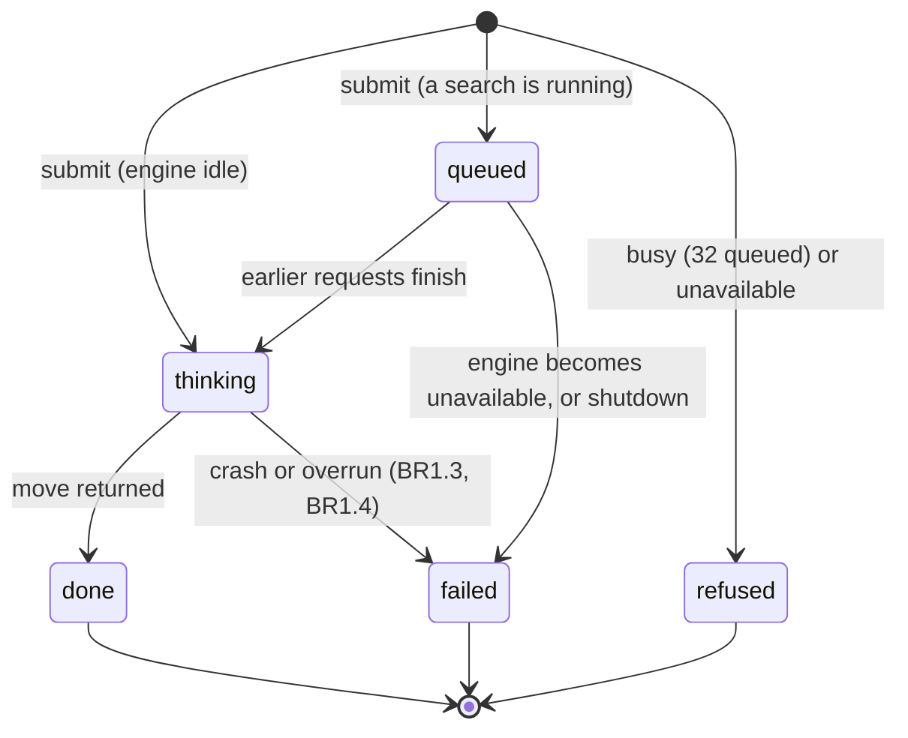
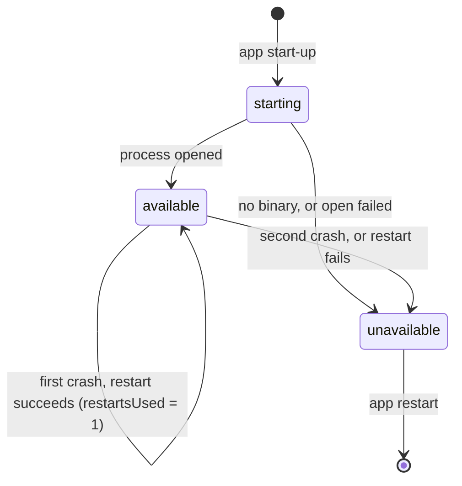
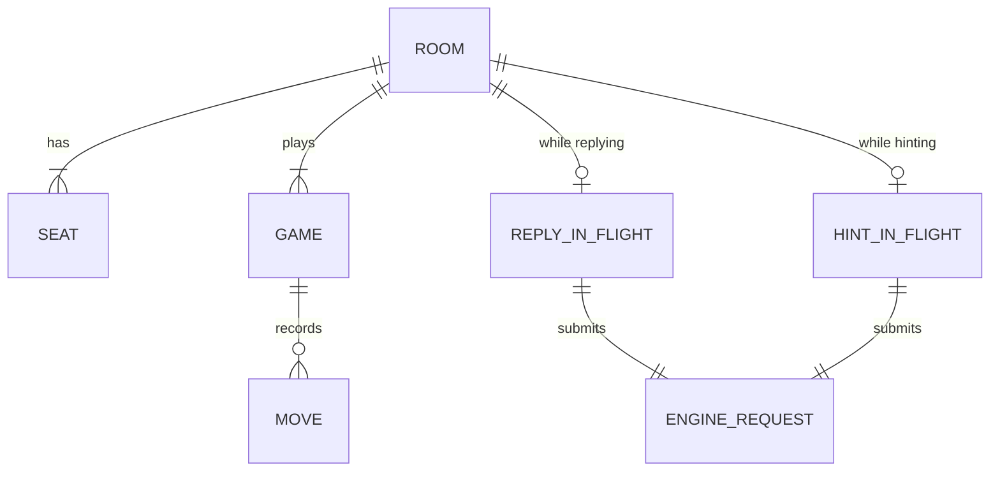

# Functional Specification — u4-play-the-computer

**Unit:** U4, kind service.
**Delivers:** FR1.5 and FR6.1–FR6.9, under NFR1 and ADR-001, ADR-002, ADR-005 and ADR-009.
**Builds on:**
- U2's schema v4: room `mode` and `computer_level`, seat `is_computer`, and the summaries.
- U3's mode checks.
- The existing Stockfish discovery (`stockfish_install.ensure_stockfish`, `GET /api/engine`).

There are no stories (the refactor scope has none), so this spec traces to the FR IDs.

## Decisions taken in this design
These were made here because the requirements and ADRs leave them open. Each is the plainest option, and the person can change it at review:
- **Takeback** is allowed only while the game is playing. After a game ends, "Play again" is the way on, so a recorded score is never undone.
- **Moves while the engine is down.** When the engine is unavailable, the player cannot move (BR5.5), so a game never waits on a computer that cannot answer. Takeback and resign still work.
- **Choosing a colour for a finished level.** Pressing "Play" for a level whose saved game is finished starts a rematch in the chosen colour. Random swaps colours (BR3.4, BR3.5).
- **Limits.**
  - The engine queue holds at most 32 requests (BR1.2).
  - Hints are refused once 16 requests are queued, so that replies keep their place (BR6.1).
  - Each room has at most one hint in flight.
  - Per-address limits apply to computer room creation (10 per minute), hints (20 per minute) and computer-move (30 per minute) (BR6.2).
- **Engine restarts.** The engine gets one restart for the life of the app. Two crashes at any distance apart need the operator to restart the app (BR1.3, ADR-001).
- **Stale replies.** A reply is tied to its game id as well as its version. A rematch replaces an in-flight reply at once, and the old search's result is discarded (BR5.1, BR5.2).
- **Resign** is added for computer games only. Friend games keep their existing claims.

## Engine request states

Text form: a request is queued, or starts thinking when the engine is idle, or is refused at once. A queued request becomes thinking when its turn comes. Thinking ends as done, or as failed on a crash or overrun. Queued requests fail only when the engine becomes unavailable or the app shuts down.

## Engine health

Text form: the engine starts in "starting", where it reports unavailable with the reason "The computer is starting" (Stockfish may still be downloading). It becomes available once its process opens, or unavailable when no binary exists or opening fails. The first crash is followed by a single restart, and the engine stays available if the restart works. A second crash, or a failed restart, makes it unavailable until the app restarts.

## Computer state shown to the player (BR7.1)

| State | When | Page shows |
|---|---|---|
| idle | the player's turn, or the game is over | normal controls |
| queued | the reply request is waiting behind others | "Waiting for the computer… (n ahead)" |
| thinking | the reply search is running | "Computer is thinking…" |
| unavailable | EngineStatus.available is false | the reason; moving and Hint are disabled |

## W1 Start a game against the computer (BR3.1, BR3.5, BR8.1)
1. The lobby loads `GET /api/engine`. When the engine is unavailable, the panel shows the reason and Play is disabled.
2. The player picks a colour and a level. Both are remembered on the device. The player presses Play.
3. The client looks for a saved seat with kind computer at that level.
   - **None:** it sends `POST /api/rooms` with `{kind: computer, level, colour}`.
   - **Found:** it opens that room. If the game is finished, it sends `POST …/rematch` with `{token, colour}`.
4. The server creates the room, both seats and game 1 in status playing, and returns `{code, token, slot: A, colour, computer}`. The client saves the seat with kind computer and the level, then opens `/r/{code}`.
5. If the computer is White, the server asks for its reply in the same request (W3). The answer then shows queued or thinking.

## W2 Player moves (BR5.1, BR5.5, BR4.2, BR8.3)
1. The blunder check runs first when the setting is on (the existing check-move flow).
2. `POST …/moves` arrives. If the engine is unavailable, the answer is 503 and nothing changes.
3. Under the room lock the move is applied. In a computer room the end check also covers threefold repetition and the 50-move rule. When the game ends, the score is recorded.
4. If the game is still playing, it is now the computer's turn. The server commits and notes the game id and version.
5. **After the lock is released:**
   - The reply is enqueued with Engine synchronously, which returns its request id and state.
   - ReplyInFlight is set to {gameId, version, requestId}.
   - A task held in a strong-reference set awaits the result. It clears the flag in a `finally`, and only if the flag still carries its request id.
6. The answer is the player's snapshot, with `computer.state` queued (and its position) or thinking. If the request was refused as busy, the state is idle with the busy message.

## W3 Computer replies (BR1.1, BR2.1, BR5.2, BR5.6, BR7.2)
1. Engine queues the request. Each time its position changes, the room's sockets get `{type: computer, state: queued, queuePosition}`. When its search starts, they get `{state: thinking}`.
2. Engine sets the level's skill and searches for the level's think time. It runs from the board replayed from stored moves.
3. **On a move:** the server re-takes the room lock. The move is applied as seat B (with the end check and the score) only if all of these hold:
   - the current game id and version match the noted ones;
   - the game is playing;
   - it is seat B's turn;
   - the move is legal.

   Otherwise it is discarded.
4. **On a failure:** nothing changes in the game. A failure other than busy sets a 5-second retry backoff for the room.
5. ReplyInFlight is cleared (if it still carries this request id) and the room is broadcast. After a failure the state shown is unavailable (with its reason) or idle. The client retries at most 3 times, 5 s apart, then shows "The computer didn't answer." with a Try again button.

## W4 Resume (BR5.4)
1. The client opens a computer room. If the snapshot shows the computer to move and the state is idle (for example after a server restart), it calls `POST …/computer-move` once.
2. The server runs W2 steps 4–6 if the game qualifies. Otherwise it returns the current state.

## W5 Take back (BR4.1, BR5.3, BR7.2)
1. The player presses Take back. The client sends `POST …/takeback` with `{token, version}`.
2. Under the lock the server checks, in order:
   - it is a computer room;
   - the token is seat A's;
   - the game is playing;
   - the version matches;
   - no reply is in flight;
   - there is something to take back.
3. It deletes one or two move rows, rebuilds the position from the remaining moves, and increases the version.
4. The sockets get `{type: takeback}`, then the new state. The answer is the snapshot.

## W6 Hint (BR6.1, BR2.2)
1. The player presses Hint. The client sends `POST …/hint` with `{token, version}`.
2. The server checks the room, seat, status, turn, version and availability, and that no hint is already in flight. It sets HintInFlight and submits a full-strength 0.5 s request.
3. When the move is back, the server checks the version again:
   - **unchanged:** it answers `{uci, from, to, san, version}`;
   - **changed:** it answers 409 with the snapshot.

   HintInFlight is cleared either way.
4. The client draws an arrow from `from` to `to`. The next move, a takeback or a new version clears it.

## W7 Resign and play again (BR4.3, BR3.4)
1. The player presses Resign and confirms in the page's dialog. The client sends `POST …/resign` with `{token, version}`.
2. The game ends with reason resigned, and the computer wins. The score is recorded. Any reply in flight is later discarded (BR5.2).
3. The result card shows "Play again". It sends `POST …/rematch` with `{token}`, and the next game starts with colours swapped. If the computer is White, W3 follows.

## W8 Engine lifecycle (BR1.3–BR1.5)
1. **Start-up.** After `ensure_stockfish` finishes, Engine opens the process with Threads = 2 and Hash = 64. Failure marks it unavailable with a reason. Start-up never waits on the engine more than it does today.
2. **Crash.** The running request fails. On the first crash the process is restarted once and the queued requests continue. On the second, everything fails and the engine is unavailable.
3. **Shutdown.** Queued requests fail. The process is asked to quit and is killed after 2 s.
4. **Reporting.** `GET /api/engine` keeps its fields `{available, path_source, version}` and adds `reason`. `available` is now also false while starting and after a fatal crash. The binary path is never exposed.

## API summary

| Route | Body | Success | Errors |
|---|---|---|---|
| `POST /api/rooms` | `{kind: computer, level, colour}` | 201 `{code, token, slot, colour, computer}` | 400 bad level or colour; 429 rate limit; 503 unavailable |
| `POST /api/rooms/{code}/moves` | unchanged | snapshot plus `computer` | 503 when the engine is unavailable (computer rooms) |
| `POST /api/rooms/{code}/computer-move` | `{token}` | snapshot | 403 not seat A; 409 not a computer room; 429 rate limit |
| `POST /api/rooms/{code}/takeback` | `{token, version}` | snapshot | 403; 409 friend room, over, stale, in flight, nothing |
| `POST /api/rooms/{code}/hint` | `{token, version}` | `{uci, from, to, san, version}` | 403; 409 not your turn, stale, hint pending; 429 rate limit; 503 busy (16+ queued) or unavailable |
| `POST /api/rooms/{code}/resign` | `{token, version}` | snapshot | 403; 409 friend room, over, stale |
| `POST /api/rooms/{code}/rematch` | `{token, colour?}` | snapshot | 409 not over |
| `POST /api/rooms/{code}/join` | unchanged | rejoin by seat A's token | 409 "This room plays the computer" |
| `POST …/claim-draw`, `…/claim-win` | unchanged | — | 409 in computer rooms |
| `GET /api/engine` | — | `{available, path_source, version, reason}` | — |

Every POST is origin-checked, as the existing routes are. Tokens travel only in bodies and are never logged.

## Error and edge cases
- **A takeback or resign while a reply is in flight.** A takeback is refused (BR5.3). A resign is allowed; the reply then finds a finished game and is discarded.
- **Resign, then Play again before the old search returns.** The rematch replaces the room's ReplyInFlight with the new game's request. If the computer is White in the new game, its reply is asked for at once. When the old search returns, its game id no longer matches, so it is discarded, and it leaves the new flag alone.
- **A hint whose page closes while it waits.** The queued request is cancelled (or its result dropped if it is already thinking), and HintInFlight is cleared.
- **Two tabs both press Play again.** The first starts the game. The second gets 409 because the game is no longer finished, and the client simply refreshes.
- **A server restart during a reply.** The flag is gone, and resume (W4) asks again.
- **The engine returns an illegal or no move.** This is treated as a failure (BR1.6, BR5.6) and logged.
- **The queue is full.** The move commits, then the reply is refused as busy. The state is idle with the message "The computer is busy, try again in a moment", and the client retries computer-move after 5 s. A hint is refused with 503.
- **A computer room idle for 30 days** is deleted like any room (existing Housekeeping), and its saved seat then drops on "not found".
- **The computer is White in game 1.** The reply is asked for at creation, so the player sees "Computer is thinking…" at once.
- **Insufficient material, stalemate or checkmate after the computer's move.** The game ends in W3 step 3, and the score is recorded.

## Entity view (derived from entities.md)

Text form: a room has two seats and plays games, and each game records moves. While a reply or a hint is in flight, the room holds one in-memory flag of that kind, and each flag is backed by one engine request.

## Rules summary (derived from rules.md)
- **Engine:** BR1.1–BR1.6 cover one search at a time with a FIFO queue capped at 32, one restart, an overrun counted as a crash, the lifecycle, and validated positions only.
- **Levels and hints:** BR2.1 is the level table. BR2.2 makes hints full strength for 0.5 s.
- **Rooms:** BR3.1–BR3.6 cover creation, no joining, the score against the computer, the one-seat rematch, one saved room per level, and no friend-only actions.
- **Game rules:** BR4.1 is takeback, BR4.2 the automatic draws, and BR4.3 resign.
- **Reply flow:** BR5.1–BR5.6 ask for the reply after the commit with no lock held, apply it only to an unchanged game, refuse takebacks and second asks while a reply is in flight, ask again on resume, refuse moves while unavailable, and handle failures.
- **Hints and limits:** BR6.1 is the hint route. BR6.2 sets the per-address limits on engine routes.
- **Live updates:** BR7.1 puts the computer state in every snapshot. BR7.2 sends the socket events.
- **Web client:** BR8.1–BR8.4 cover the lobby panel, the game screen, the blunder warning and Your games.

## Tests (test-after, Standard)
- **Engine against a fake UCI engine** (a small script speaking UCI):
  - FIFO order and queue positions;
  - one search at a time;
  - queue cap;
  - crash then restart;
  - second crash then unavailable;
  - overrun handled as a crash;
  - shutdown fails queued requests.
- **One real-engine test:** Maximum level, reply within 3 s on this machine. Skipped with a reason when Stockfish is missing.
- **Level mapping and hint settings.**
- **Rooms:**
  - computer creation with each colour (random covered by an injected chooser);
  - join refused;
  - the score recorded against the computer;
  - claims refused.
- **Takeback:**
  - two plies on the player's turn;
  - one ply when the engine is down;
  - refused in friend rooms, when over, when stale, while in flight, and when there is nothing to take back.
- **Automatic draws:** threefold and fifty moves end computer games; friend games are unchanged.
- **Reply race:**
  - a stale reply is discarded after a takeback, a resign or a rematch;
  - resign then rematch with the computer White while a reply is in flight: the new game gets its own reply, and the old one is discarded without clearing the new flag;
  - resume asks once;
  - a failure leaves the game unchanged and sets the 5 s backoff;
  - the flags are cleared after an exception or cancellation.
- **Rate limits:** each engine route's per-address limit gives 429, and hints are refused at 16 queued.
- **Draws:** the claim-aware end path applies to computer rooms only; a friend room repetition still needs a claim.
- **API:**
  - the hint flow and its errors;
  - resign;
  - rematch with a colour;
  - 503 moves while unavailable;
  - the computer state in the snapshot;
  - the socket events;
  - no tokens in logs.
- **JS:**
  - `computer.js`: level names, status text, which buttons show, and the arrow geometry;
  - the lobby panel remembers its choices and its unavailable state.
- **Browser:** a short game against the computer in headless Chromium. It is skipped when Chromium or Stockfish is missing.
- **NFR1 timing** on the Pi at Maximum, with the real engine.

## Sources
- `inception/units-generation/unit-of-work.md` (U4)
- `inception/requirements-analysis/requirements.md` (FR1.5, FR6.1–FR6.9, NFR1)
- `inception/domain-design/components.md`, and `decisions.md` ADR-001, ADR-002, ADR-005 and ADR-009
- Existing code: `justchess/api.py`, `games.py`, `rooms.py`, `live.py`, `summaries.py`, `stockfish_install.py`, `static/js/seat-store.js`, `your-games.js`
