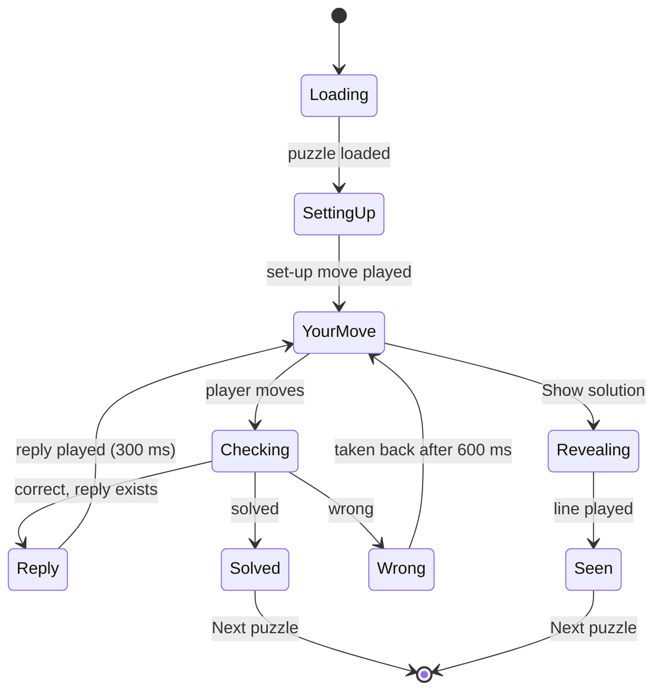
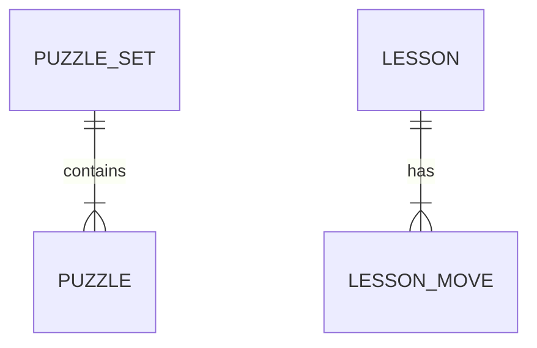

# Functional Specification — u5-lessons-and-puzzles

U5 expands the opening trainer, adds traps, defence lessons and tactics puzzles, and turns `/learn` into a tabbed trainer hub. The entities are in `entities.md` and the rules in `rules.md`. Inputs: requirements FR7, FR8.1 and FR8.3–FR8.6, NFR4 and NFR6; ADR-004; mockups Screens 7–8; interaction spec (TrainerHub, PuzzleBoard).

## W1 Lessons with kinds (BR1.1–BR1.3)
1. The existing loader (`justchess/lessons.py`) accepts an optional `kind` field. It is added to `KNOWN_FIELDS`, validated, and included in `summaries()`. On the client, `isSummary` in `lessons-api.js` accepts the field. The trainer's own `choosing` phase stays for the game-screen drawer. The hub owns lesson selection on `/learn`.
2. `GET /api/lessons?kind=trap` filters by kind. Without `kind`, every lesson is returned, as today.
3. New files go into `lessons/`:
   - 8 openings: `ruy-lopez`, `sicilian`, `french`, `caro-kann`, `queens-gambit`, `london`, `kings-indian`, `scandinavian`;
   - 4 traps: `legals-mate`, `fried-liver`, `fishing-pole`, `englund-gambit-trap`;
   - 4 defence lessons: `scholars-mate-defence`, `fried-liver-defence`, `early-queen-raids`, `wayward-queen`.
4. The two existing files (`italian`, `monte-carlo`) stay openings.
5. Lesson content is written in our own words. Lines are standard theory: main lines from common opening references, and well-known trap sequences.

## W2 Puzzle curation, done once at build time (BR2.2)
1. `scripts/curate_puzzles.py` takes the path of a downloaded `lichess_db_puzzle.csv.zst`. That file is fetched by the developer from https://database.lichess.org/#puzzles and is not committed (`.gitignore`). The script reads the CSV from a plain file or from standard input, so the compressed file is streamed through the `zstd` command (`zstd -dc lichess_db_puzzle.csv.zst | uv run python scripts/curate_puzzles.py -`). No new Python dependency is needed.
2. Per theme, it keeps puzzles whose Lichess `Themes` include the theme tag. It filters to `Popularity ≥ 80`, `NbPlays ≥ 500` and rating 600–2200. It then runs the same validators as BR2.1 (shared code from `justchess/puzzles.py`) before sampling 300 evenly across the rating range with a fixed random seed. Only valid puzzles are ever sampled, so the 250 floor holds when enough candidates exist. The CSV columns used are PuzzleId, FEN, Moves, Rating, Popularity, NbPlays and Themes.
   The developer runs the script once during Code Generation, downloading the file to a git-ignored folder, and commits the output in `puzzles/`. If the download is unavailable, the build stops and the gap is reported. No made-up or unverified puzzles are shipped.
3. It writes `puzzles/<theme>.json` in the PuzzleSet shape, sorted by rating, and `puzzles/LICENSE.md` with the CC0 notice, the source URL, the date and the filter.
4. It prints counts and the total size, and fails if any theme ends up under 250 puzzles or the total is over 5 MB.

## W3 Puzzle service, at runtime (BR2.1, BR2.3, BR2.4)
1. At start-up, `justchess/puzzles.py` loads `puzzles/*.json` (directory overridable with `JUSTCHESS_PUZZLES_DIR` for tests), validates each puzzle and keeps the valid ones in memory, about 1,800 small records.
2. Routes:

   | Route | Returns |
   |---|---|
   | `GET /api/puzzles` | `[{theme, label, count}]` |
   | `GET /api/puzzles/{theme}` | `[{id, rating}]` in rating order |
   | `GET /api/puzzles/{theme}/{id}` | `{id, theme, fen, setup: moves[0], playerMoves: count, rating}`; the solution is not included |
   | `POST /api/puzzles/{theme}/{id}/check` | Body `{ply, uci}`; returns `{result: correct\|wrong\|solved, reply?}` per BR2.4 |
   | `POST /api/puzzles/{theme}/{id}/hint` | Body `{ply, level: piece\|move\|solution}`; returns `{from}`, `{uci}` or `{line}` per BR2.4 |
   | `GET /learn/tactics/{theme}` | Page route serving the app shell, so a direct load or refresh of the puzzle screen works |

3. All routes only read data, are size-limited and origin-checked (POST), and require no seat or token.

## W4 Trainer hub (BR3.1, BR3.2, BR3.4)
1. `/learn` renders the hub. The tab registry (`static/js/training/hub-tabs.js`) lists Openings, Traps, Tactics and Defence. U6 calls `registerTab({id:'endgames', …})`.
2. Lesson tabs load `GET /api/lessons?kind=…`. The Tactics tab loads `GET /api/puzzles` and shows one row per theme ("Forks · 300 puzzles · 12 solved").
3. Progress counts come from `trainer-progress.js`, a per-device store.
4. A lesson row opens the existing trainer (`/learn/<id>`). A theme row opens the puzzle screen at the first unsolved puzzle (`/learn/tactics/<theme>`).
5. The "Learn openings" drawer in the game screen keeps listing openings only (`kind=opening`).

## W5 Puzzle screen (BR2.3–BR2.5, BR3.3)

Text fallback:
- **Loading:** goes to SettingUp, which plays the set-up move.
- **Your move:** the player's move is checked:
  - correct, with a reply: the reply plays after 300 ms, then it is the player's move again;
  - solved: the puzzle is done;
  - wrong: shown, then taken back after 600 ms.
- **Show solution:** plays the line and marks the puzzle as seen, not solved.
- **Next puzzle:** leaves the Solved or Seen state.

The screen reuses the board module (with U1's capture animation), the status line and the arrow module. The status reads "White to move: find the fork" (theme label), with "Forks · puzzle 12 of 300" under it.

## Error and edge cases

| Case | Behaviour |
|---|---|
| `puzzles/` missing | Tactics tab shows "Puzzles are not installed"; the other tabs work |
| Network error on check | Banner "Couldn't check that move. Try again." The move is taken back with no verdict |
| A different mate on a mate-in-2's last move | Accepted as solved (BR2.4) |
| The same move order but an alternative capture of equal value | Wrong, unless it gives mate (puzzles have one solution) |
| Storage blocked | No progress shown; everything else works |
| The opponent's set-up move is a capture | U1's capture animation plays |

## Entity view

Text fallback: a puzzle set file contains many puzzles, and a lesson has many moves. Progress is kept separately in the browser.

## Rules summary (derived)

| Group | Rules |
|---|---|
| Lessons | BR1.1–BR1.3 |
| Puzzles | BR2.1–BR2.5 |
| Hub | BR3.1–BR3.4 |

## Tests (test-after, Standard)
- **Python**
  - `tests/test_lessons.py`, extended:
    - the kind default and a bad kind skipped;
    - every shipped lesson loads with no skips;
    - the counts per kind are at least 8 openings + 2 existing, 4 traps and 4 defence.
  - `tests/test_lessons_api.py`: the `?kind` filter and 400 for a bad kind.
  - `tests/test_puzzles.py`:
    - validation (illegal move, a mate theme without mate, a wrong player-move count, a wrong theme) skips the puzzle;
    - every shipped puzzle loads, 250–400 per theme, the total at most 5 MB, and `LICENSE.md` present;
    - the check route returns correct with a reply, solved, wrong, an alternative mate as solved, reveal, 404 and 400.
  - `tests/test_curate_puzzles.py`: the script on a tiny fixture CSV (plain-text path) with filtering, sampling and output shape. It does not need the real download.
- **JS**
  - `tests/js/trainer-progress.test.mjs`: write, read, counts, storage failure.
  - `tests/js/hub-tabs.test.mjs`: the registry order, `registerTab`, keyboard navigation logic.
  - `tests/js/puzzle-state.test.mjs`: the state machine above.
- **Browser:** `tests/test_u5_trainer_browser.py`. The hub tabs switch by keyboard, the Tactics tab lists its themes, and one fixture puzzle is solved.

## Sources
- `inception/requirements-analysis/requirements.md` FR7, FR8.1, FR8.3–FR8.6, NFR4, NFR6
- `inception/domain-design/decisions.md` ADR-004
- `inception/refined-mockups/mockups.md` Screens 7–8; `interaction-spec.md`
- `inception/units-generation/unit-of-work.md` U5
