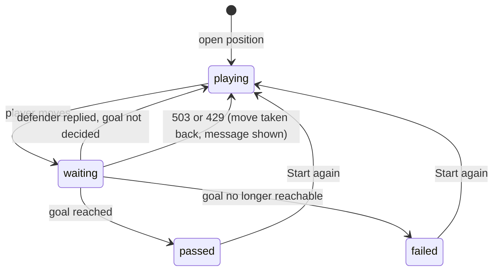
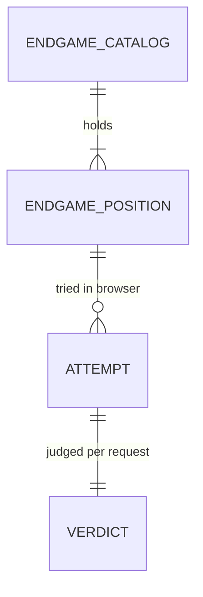

# Functional Specification — u6-endgame-trainer

**Unit:** U6 (service).
**Delivers:** FR8.2, the Endgames part of FR8.1, and the endgame part of FR6.7.
**Builds on:**
- U4's Engine (the shared queue), its availability status and `gameplay.yaml`;
- U5's trainer hub, its tab registry and per-device progress;
- U3's rate limiter.

There are no stories, because the refactor scope has none.

## Decisions taken in this design
These are made here because the requirements and ADRs leave them open. Each is the plainest option, and the person can change it at review.
- **Files.** Positions live in `endgames/<category>.yaml`, one file per category, in the same style as `lessons/`. There is no environment setting for the folder, and tests pass a folder to `create_app`.
- **No server session.** The client sends the whole move list each time (ADR and unit decision). Earlier defender moves are replayed as given and not checked again. That is acceptable because progress is per device and nothing is scored on the server.
- **Waiting is shown as "thinking" only.** A play request waits for the engine inside the HTTP call, so the page shows "Computer is thinking…" while it waits. There is no room socket for endgames, so a live queue position is not shown. When the queue is full, the request is refused with the busy message.
- **Hints are text.** The hint is the position's own text, not an engine move. It costs nothing and teaches the idea rather than the move.
- **Settings.** A new `endgames` section of `gameplay.yaml` holds:
  - the defender's strength (skill 20, 1 s);
  - the 30-move hold target;
  - the 300-ply cap;
  - the per-address limit (30 per minute);
  - the queue threshold (16), above which endgame plays are refused so that live computer games keep their place;
  - the 30 s wait limit.
- **Winning outright meets any goal.** Checkmating the defender passes every goal, including promote and hold-the-draw. A board that is over is never sent to the engine (BR2.6).
- **Attempt survives a reload.** The attempt is kept in session storage, so a reload continues it.

## Attempt states

Text form: an attempt is playing until the player moves, then waiting while the server judges and the defender replies. It goes back to playing, or ends passed or failed. A refusal (503 or 429) takes the player's move back and shows the message. Start again returns to playing from the start position.

## Judging table

| Goal | Passed | Failed |
|---|---|---|
| mate | the defender is checkmated | stalemate, insufficient material, threefold, fifty moves, or the player is mated |
| promote | the player's move promotes a pawn, or the defender is checkmated | the player is mated, no player pawns are left, or any draw by the rules |
| draw | the defender is checkmated, 30 player moves without being mated, or threefold, fifty moves, stalemate or insufficient material | the player is mated |

Draws are always reported by their specific reason: `stalemate`, `insufficient_material`, `threefold_repetition` or `fifty_moves`.

Any goal also fails as `too_long` when the attempt reaches 300 plies while still playing.

## W1 Open the Endgames tab (BR4.1, BR3.1)
1. The hub registers the Endgames tab. Its loader calls `GET /api/endgames`.
2. The rows are grouped by category, with Done for solved positions and the count "n of 12 done on this device".
3. If `available` is false, a note shows "Needs Stockfish: <reason>" and Play is disabled.

## W2 Play a position (BR4.2, BR3.2, BR2.1–BR2.5)
1. `/learn/endgames/{id}` loads `GET /api/endgames/{id}`. The board is oriented to the player's side, and the goal status is shown.
2. The player moves on the board, which allows legal moves only. The client appends the move and sends `POST /api/endgames/{id}/play {moves}`, showing "Computer is thinking…".
3. The server:
   1. validates the moves and replays them;
   2. judges the position after the player's move;
   3. if the attempt is still playing, gets the defender's move from Engine, applies it and judges again;
   4. answers with the verdict.
4. The client plays the reply on the board, then:
   - updates the move counter (draw goal);
   - on passed, marks the position solved and shows the success text with Next position;
   - on failed, shows the failure text with Start again.
5. On 503 or 429, the client takes the player's move back and shows the message.

## W3 Hint and start again (BR4.2)
- **Hint** shows the hint text under the board, with no request.
- **Start again** clears the attempt and the session storage, and resets the board to the start position.

## API summary

| Route | Body | Success | Errors |
|---|---|---|---|
| `GET /api/endgames` | — | `{installed, available, reason, categories}` | — |
| `GET /api/endgames/{id}` | — | `{id, category, title, fen, goal, hint, holdMoves?, index, count}` | 404 |
| `POST /api/endgames/{id}/play` | `{moves}` | `{status, reason, reply, playerMoves, movesLeft}` | 400 malformed, illegal, even length or too long; 404; 413 over the default 4 KB body limit; 429; 503 unavailable, busy (16 or more queued, queue full, or waiting longer than 30 s) |

The POST route is origin-checked like the existing ones. The page route `/learn/endgames/{id}` serves the app shell, just as the tactics page does.

## Error and edge cases
- **The player's own move ends the attempt** (mate, promotion, or a draw by the rules). The engine is not asked.
- **The defender's reply ends the attempt** (for example the player is mated, or a repetition for a mate goal). The verdict carries both the reply and the result.
- **A hold-the-draw attempt reaches 30 player moves.** The defender still replies once. It passes unless that reply is checkmate.
- **The engine fails mid-request** (crash or overrun). The answer is 503 with the reason. The client takes the move back, and the player can try again once the engine is available.
- **The client disconnects while waiting.** The queued engine request is cancelled (as for U4 hints).
- **The position id is not in the catalog.** The answer is 404. Ids are never used to build file paths.

## Entity view (derived from entities.md)

Text form: the catalog holds the positions. Each position can be tried in the browser many times, and each request of an attempt gets one verdict.

## Rules summary (derived from rules.md)
- **Content:** BR1.1 and BR1.2 cover loading and validation, and the minimum of three positions per category.
- **Judging:** BR2.1–BR2.3 judge the mate, promote and draw goals. BR2.4 caps the attempt length, and BR2.5 sets the full-strength defender.
- **HTTP:** BR3.1–BR3.3 cover the list and get routes, the play route, and the refusals for unavailable, busy and the rate limit.
- **Web client:** BR4.1 adds the Endgames tab, and BR4.2 the endgame screen.

## Tests (test-after, Standard)
- **Content** (`tests/test_endgames_content.py`):
  - every shipped position loads and is valid;
  - there are at least 3 per category;
  - every hint is present.
- **Loader** (`tests/test_endgames.py`):
  - a bad FEN, a finished position, the wrong side to move and a duplicate id are each skipped with a warning;
  - a missing folder means not installed;
  - an unknown category file is ignored.
- **Judging** (`tests/test_endgame_judge.py`, positions only):
  - mate passes;
  - stalemate fails a mate goal;
  - promotion passes;
  - losing the pawns fails;
  - 30 moves held passes;
  - a defender checkmated in a promote goal and in a draw goal passes, and the engine is not asked;
  - any other finished board ends the attempt without asking the engine;
  - repetition passes a draw goal and fails a mate goal;
  - the player mated fails;
  - too long fails.
- **HTTP** (`tests/core/test_endgames_api.py`, fake engine):
  - list, get and 404;
  - a play round trip with the reply and the verdict;
  - illegal move, even length, too long and oversized body;
  - 503 when unavailable, when the queue is full, and when 16 or more requests are queued;
  - the wait limit cancels the engine request;
  - 429;
  - the player's finishing move does not ask the engine.
- **JS:**
  - `tests/js/endgame.test.mjs`: status texts, the move counter, verdict messages, and the session-storage round trip;
  - the hub tab's loader and its "Needs Stockfish" state.
- **Browser** (`tests/test_u6_endgame_browser.py`): open the Endgames tab, play a queen-mate position with the fake engine until passed, and see Done in the tab.

## Sources
- `inception/units-generation/unit-of-work.md` (U6)
- `inception/requirements-analysis/requirements.md` (FR8.1, FR8.2, FR6.7, NFR1)
- `inception/domain-design/components.md` (Endgames, EndgamePosition)
- `inception/refined-mockups/mockups.md` (Screen 7 and Screen 9)
- Existing code: `justchess/engine.py`, `justchess/gameplay.py`, `justchess/puzzles.py`, `justchess/ratelimit.py`, `static/js/training/hub-tabs.js`, `trainer-progress.js`
