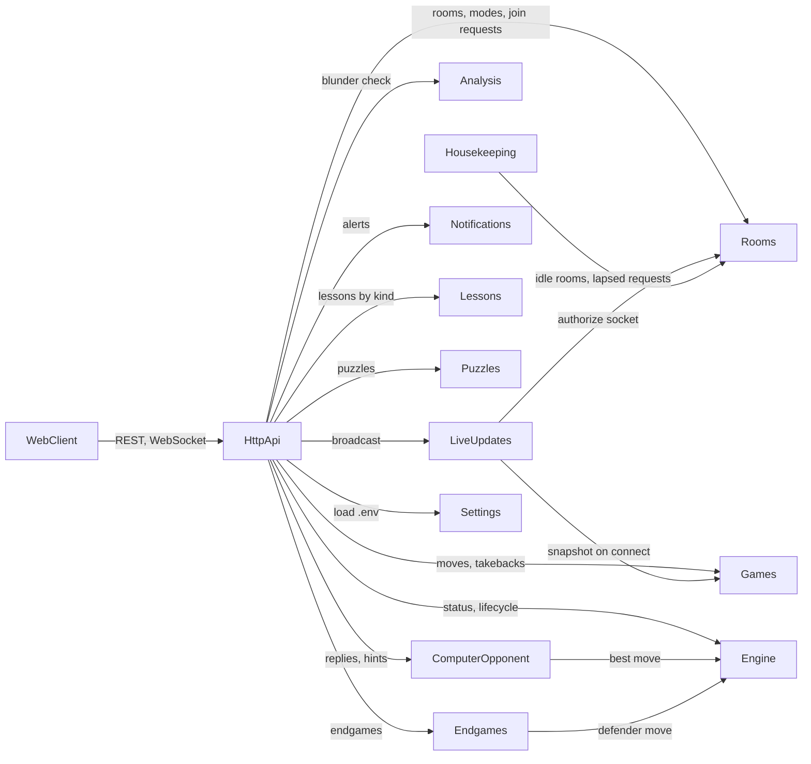

# Components — JustChess P2

The logical building blocks after this round, from `inception/requirements-analysis/requirements.md` and `inception/refined-mockups/interaction-spec.md`. The starting point is the code map (`aidlc/spaces/default/codekb/JustChess/architecture.md`, `component-inventory.md`) and the P1 catalogue (intent 261112 `inception/domain-design/components.md`). Components marked "unchanged" keep their P1 behaviour and are listed so the catalogue stays complete.

Decisions from `domain-design-questions.md`:
- one Engine process with a queue [Q1];
- a computer game is a room whose second seat belongs to the computer [Q2];
- pass-along and join requests live in Rooms [Q3];
- trainers split into Lessons, Puzzles and Endgames [Q4];
- one computer room per device and level [Q5].

```yaml
components:
  - name: Rooms
    summary: Room codes, seats, room mode (waiting, pass-along, online, computer), join requests and the room score
    behaviour: >
      Unchanged from P1: codes, hashed 128-bit seat tokens, continue tokens, per-seat score, rematch, per-room lock.
      New: every room has a mode. A friend room starts as "waiting"; the creator may switch it to "pass_along" and
      back. While in pass_along the creator's seat token authorizes moves for both colours. When a visitor opens
      the link of a pass_along room, Rooms creates a JoinRequest (one pending per room; a second gets "busy"),
      which lapses 10 minutes after creation. Only the creator's seat token can accept or decline it. On accept
      the visitor gets seat B (the seat row is created at that moment with a fresh token) and the mode becomes
      "online"; the game continues from its position and is marked counted from that moment. A waiting room joined
      directly (no pass-along) becomes online as before. A "computer" room is created with a computer level and a
      seat B row whose token hash is empty (NULL) and whose slot is flagged as the computer's; an empty token hash
      never matches any presented token, so no visitor can act as or join that seat.
      Room score counts only games marked counted. A game started in pass_along is not counted while it stays in
      pass_along; accepting a joiner marks it counted; a game that ends in pass_along stays not counted. For computer
      rooms the room score is the score against the computer at that level.
    responsibilities:
      - Room creation (friend or computer), join, seat authorization for every action, including pass-along rights
      - Room mode transitions and their rules
      - JoinRequest lifecycle (create, busy, accept, decline, lapse)
      - Seat tokens, continue tokens, room score, rematch
    depends_on: []
    dependents:
      - component: HttpApi
        interaction: create rooms, join, change mode, handle join requests, authorize seats, record results, summaries
      - component: LiveUpdates
        interaction: authorize a socket's seat or join-request token, update last-seen
      - component: Housekeeping
        interaction: delete idle rooms, expire join requests
    external_dependencies:
      - name: SQLite
        kind: database
        purpose: rooms, seats, join_requests tables
    entities:
      - name: Room
        identifier: code
        attributes: [code, mode, computerLevel, createdAt, lastActivityAt, winsA, winsB, draws, rematchRequestedBy]
      - name: Seat
        identifier: seatId
        attributes: [seatId, roomCode, slot, isComputer, tokenHash, continueTokenHash, lastSeenAt]
        references:
          - entity: Room
            owned_by: Rooms
            relationship: each Seat belongs to one Room; the computer's seat has no token hash
      - name: JoinRequest
        identifier: requestId
        attributes: [requestId, roomCode, requesterTokenHash, status, createdAt, expiresAt, answeredAt]
        references:
          - entity: Room
            owned_by: Rooms
            relationship: each JoinRequest belongs to one pass-along Room; at most one is pending per Room

  - name: Games
    summary: One game's position, rules, moves, takebacks, automatic ends and result
    behaviour: >
      Unchanged from P1: python-chess validation, version numbers, automatic ends (mate, stalemate, insufficient
      material, fivefold repetition, 75-move rule), draw claims for threefold and 50-move, snapshot. New: each game
      records whether it counts toward the room score. In computer rooms threefold repetition and the 50-move rule
      end the game automatically (no claims). A takeback removes the last two plies (the player's move and the
      computer's reply) in computer rooms only, when it is the player's turn and at least one player move exists;
      it bumps the version. The snapshot exposes the last move's captured piece and square (also for en passant) so
      clients can animate captures.
    responsibilities:
      - Game state, move list, version, counted flag
      - Rules, automatic ends with reasons, draw claims (friend rooms only)
      - Takeback (computer rooms)
      - Snapshot including capture information
    depends_on: []
    dependents:
      - component: HttpApi
        interaction: start game, apply move, take back, claim draw, read snapshot
      - component: LiveUpdates
        interaction: read snapshot on connect
    external_dependencies:
      - name: python-chess
        kind: other
        purpose: authoritative chess rules
      - name: SQLite
        kind: database
        purpose: games and moves tables
    entities:
      - name: Game
        identifier: gameId
        attributes: [gameId, roomCode, number, whiteSlot, fen, version, status, endReason, result, counted, startedAt, endedAt]
        references:
          - entity: Room
            owned_by: Rooms
            relationship: each Game belongs to one Room; a Room has one current Game
      - name: Move
        identifier: moveId
        attributes: [moveId, gameId, ply, uci, san, fenAfter, capturedPiece, capturedSquare, playedAt]
        references:
          - entity: Game
            owned_by: Games
            relationship: each Move belongs to one Game

  - name: Engine
    summary: Installs the pinned Stockfish and runs one engine process that answers move requests in turn
    behaviour: >
      Install part unchanged (stockfish_install.py, checksum-verified, app starts without it). New: one long-running
      Stockfish process via python-chess's asynchronous UCI interface, with Threads <= 2 and Hash <= 64 MB. Requests
      (position, skill level, think time) wait in one first-in-first-out queue and run one at a time, never on the
      web server's event loop. Reports queue position so callers can show "waiting" vs "thinking". If the process
      dies, it restarts once; if that fails the engine reports unavailable. When the binary is missing it reports
      unavailable with the reason and every request fails fast.
    responsibilities:
      - Engine install and status
      - Engine process lifecycle (start, restart, shutdown)
      - Request queue and best-move searches
    depends_on: []
    dependents:
      - component: ComputerOpponent
        interaction: best move for a level
      - component: Endgames
        interaction: full-strength defending move
      - component: HttpApi
        interaction: status, startup and shutdown hooks
    external_dependencies:
      - name: Stockfish binary (sf_19, downloaded from GitHub releases)
        kind: other
        purpose: chess engine over UCI
    entities:
      - name: EngineJob
        identifier: jobId
        attributes: [jobId, fen, skillLevel, thinkTime, enqueuedAt, state]

  - name: ComputerOpponent
    summary: The five named levels and the computer's moves and hints in computer rooms
    behaviour: >
      Maps Beginner, Casual, Club, Strong and Maximum to skill 0/5/10/15/20 and think time 0.1/0.3/0.6/1/2 s. Asks
      Engine for the computer's reply and for hints (a hint is a full-strength best move for the player's side,
      0.5 s). Never applies moves itself; HttpApi applies the returned move through Games.
    responsibilities:
      - Level table
      - Computer reply and hint requests
    depends_on:
      - component: Engine
        interaction: best move for a position at a level
        style: async
    dependents:
      - component: HttpApi
        interaction: get the computer's reply after a player move or on resume; get a hint
    external_dependencies: []
    entities: []

  - name: Analysis
    summary: Blunder warnings for a proposed move (unchanged)
    behaviour: >
      Unchanged from P1: python-chess only, mate-in-one and hanging pieces the move itself creates. Applies in
      computer rooms too.
    responsibilities:
      - Move check for blunder warnings
    depends_on: []
    dependents:
      - component: HttpApi
        interaction: check a proposed move
    external_dependencies:
      - name: python-chess
        kind: other
        purpose: move generation
    entities: []

  - name: LiveUpdates
    summary: WebSocket connections per room and broadcast of room events
    behaviour: >
      Unchanged from P1: seat-authorized sockets, snapshots on connect, broadcasts, reconnect. New events: mode
      changed, join request created/answered/lapsed (creator only), computer thinking/queued, takeback. A visitor
      with a pending join request may hold a request-scoped socket: it authenticates with the request token (sent in
      the first message, never in the URL), which Rooms verifies against the stored hash; it receives only that
      request's answer or lapse and is closed after it.
    responsibilities:
      - Connections and broadcasts, including the new event kinds
      - Request-scoped sockets for pending join requests
    depends_on:
      - component: Rooms
        interaction: authorize a socket's seat or join-request token, update last-seen
        style: sync
      - component: Games
        interaction: read snapshot on connect
        style: sync
    dependents:
      - component: HttpApi
        interaction: broadcast events after state changes
    external_dependencies: []
    entities: []

  - name: Notifications
    summary: One alert per event through page banner, service worker and Web Push
    behaviour: >
      Unchanged from P1, plus one new event kind: "join request" to the creator's seat, with the same
      one-alert rule. No alerts for computer rooms' computer moves (the player is on the page).
    responsibilities:
      - Push subscriptions, alert records, delivery
    depends_on: []
    dependents:
      - component: HttpApi
        interaction: notify a seat of an event
    external_dependencies:
      - name: Browser push services (FCM, Mozilla, Apple)
        kind: third-party-api
        purpose: Web Push delivery
      - name: SQLite
        kind: database
        purpose: push_subscriptions, alert_records
    entities:
      - name: PushSubscription
        identifier: subscriptionId
        attributes: [subscriptionId, seatId, endpoint, p256dh, auth, createdAt]
        references:
          - entity: Seat
            owned_by: Rooms
            relationship: each subscription belongs to one Seat
      - name: AlertRecord
        identifier: alertKey
        attributes: [alertKey, seatId, event, sentAt]
        references:
          - entity: Seat
            owned_by: Rooms
            relationship: each record belongs to one Seat

  - name: Lessons
    summary: Walkthrough-and-practice lessons from files, now of three kinds (opening, trap, defence)
    behaviour: >
      Unchanged loader and validation from P1 (YAML or JSON, every line replayed legally, bad file skipped with a log
      line). New: each lesson declares a kind (opening, trap, defence; default opening for old files). Adds 8
      openings, 4 traps and at least 4 defence lessons.
    responsibilities:
      - Lesson loading, validation, listing by kind
    depends_on: []
    dependents:
      - component: HttpApi
        interaction: list lessons by kind, get a lesson
    external_dependencies:
      - name: Lesson files (lessons/*.yaml or *.json)
        kind: other
        purpose: lesson content
    entities:
      - name: Lesson
        identifier: slug
        attributes: [slug, kind, title, side, lines]

  - name: Puzzles
    summary: The curated tactics set (about 300 per theme) and solution checking
    behaviour: >
      Loads the shipped puzzle files once at startup (a curated CC0 subset of the Lichess puzzle database, <= 5 MB
      total), validating each puzzle (legal start position, legal solution line) and skipping bad ones with a log line.
      Serves puzzles by theme and index. Checks a submitted move against the solution and returns correct (with
      the scripted reply), wrong, or solved. Nothing is downloaded.
    responsibilities:
      - Puzzle loading and validation
      - Listing by theme, getting a puzzle, checking moves
    depends_on: []
    dependents:
      - component: HttpApi
        interaction: list themes and counts, get a puzzle, check a move
    external_dependencies:
      - name: Puzzle files (shipped in the repo, from the Lichess CC0 puzzle database)
        kind: other
        purpose: puzzle content
      - name: python-chess
        kind: other
        purpose: validation
    entities:
      - name: Puzzle
        identifier: puzzleId
        attributes: [puzzleId, theme, fen, solution, rating, sourceId]

  - name: Endgames
    summary: Endgame positions, their goals, and judging the result against a full-strength defender
    behaviour: >
      Loads hand-written endgame files (at least 3 positions each for queen mate, rook mate, king and pawn,
      opposition). Each position has a goal: mate, promote, or hold the draw. Judges each move sequence: mate or
      promotion passes; for hold-the-draw, reaching 30 player moves without losing, threefold repetition or the
      50-move rule passes; a loss, or for mate/promote goals a draw, fails. Asks Engine for the defender's moves at
      full strength (skill 20, 1 s). Holds no server-side session: the client sends the move list each time.
    responsibilities:
      - Endgame position loading and validation
      - Goal judging
      - Defender move requests
    depends_on:
      - component: Engine
        interaction: full-strength defending move
        style: async
    dependents:
      - component: HttpApi
        interaction: list positions, get a position, play a move and get the defender's reply and verdict
    external_dependencies:
      - name: Endgame files (shipped in the repo)
        kind: other
        purpose: position content
      - name: python-chess
        kind: other
        purpose: rules and draw detection
    entities:
      - name: EndgamePosition
        identifier: positionId
        attributes: [positionId, category, title, fen, goal, hint]

  - name: Housekeeping
    summary: Scheduled clean-up
    behaviour: >
      Unchanged from P1 (idle rooms deleted after 30 days, with their games, seats, subscriptions and alerts). New:
      marks lapsed join requests (also checked lazily on read) and deletes join requests with their room.
    responsibilities:
      - Idle room deletion, join request expiry
    depends_on:
      - component: Rooms
        interaction: find and delete idle rooms, expire join requests
        style: sync
    dependents: []
    external_dependencies: []
    entities: []

  - name: Settings
    summary: Loads the project's .env file into the environment before anything reads it (FR9, already built)
    behaviour: >
      Reads KEY=VALUE lines from .env at the project root; a variable already set in the shell wins; malformed lines
      are skipped and logged without their values; a missing file is fine. Secrets stay in their own files outside
      the repo.
    responsibilities:
      - .env loading at start-up
    depends_on: []
    dependents:
      - component: HttpApi
        interaction: called first by the entry point, before configuration is read
    external_dependencies:
      - name: .env file (git-ignored)
        kind: other
        purpose: local settings
    entities: []

  - name: HttpApi
    summary: FastAPI routes; orchestrates every cross-component flow; rate limits and summaries
    behaviour: >
      Unchanged role from P1 (ADR-003 of intent 261112): components never call each other except Housekeeping to
      Rooms, ComputerOpponent to Engine and Endgames to Engine. New flows: create computer room; after a player's
      move in a computer room, ask ComputerOpponent for the reply, apply it through Games, broadcast; resume runs the
      same when it is the computer's turn; takeback; hint; mode changes; join request create/answer; batch room
      summaries (tokens only in the body; rooms with a wrong token or missing come back "not found"); puzzles;
      endgames; lesson kinds. On accepting a join request, HttpApi calls Rooms (seat B, mode online) and then
      Games (mark the current game counted) under the same room lock. Rate limit for join requests: 5 per minute per client IP address, kept in memory; the
      client address rule is in ADR-006 (JUSTCHESS_TRUSTED_PROXIES).
      Computer replies: after a player move commits (room lock released), HttpApi records the resulting game version,
      asks ComputerOpponent for the reply without holding any lock, then re-takes the room lock and applies the reply
      only if the game version is still the recorded one and it is still the computer's turn; otherwise the reply is
      discarded. Resume and a racing move use the same rule, so at most one reply is ever applied per position.
      Takeback is refused while a reply is in flight for that room (an in-memory per-room flag), with "The computer is
      thinking".
    responsibilities:
      - Routes, request validation, size limits, origin checks
      - Orchestration of all flows above
      - Join-request rate limit
      - Batch summaries for the ongoing-games list
    depends_on:
      - component: Rooms
        interaction: rooms, seats, modes, join requests, score
        style: sync
      - component: Games
        interaction: moves, takebacks, snapshots
        style: sync
      - component: Engine
        interaction: status, lifecycle hooks
        style: sync
      - component: ComputerOpponent
        interaction: computer replies and hints
        style: async
      - component: Analysis
        interaction: blunder checks
        style: sync
      - component: LiveUpdates
        interaction: broadcasts
        style: async
      - component: Notifications
        interaction: alerts, including join requests
        style: async
      - component: Lessons
        interaction: lessons by kind
        style: sync
      - component: Puzzles
        interaction: puzzles and move checks
        style: sync
      - component: Endgames
        interaction: positions, defender replies, verdicts
        style: async
      - component: Settings
        interaction: load .env first
        style: sync
    dependents:
      - component: WebClient
        interaction: HTTP and WebSocket calls
    external_dependencies:
      - name: FastAPI / Uvicorn
        kind: other
        purpose: web framework
    entities: []

  - name: WebClient
    summary: The browser tier (native ES modules): all screens, animations, dialogs and device storage
    behaviour: >
      Unchanged foundations from P1. New: Your games list (from stored seats plus batch summaries; drops a seat only
      on "not found"; refresh on load, focus and every 60 s); computer setup panel and computer game screen (thinking
      states, takeback, hint arrow, resign dialog, result card, score line); capture animation (260 ms shrink and
      fade, reduced motion respected); board fit (min of width and available height; edge to edge under 400 px
      portrait; landscape layout); share dialog (native dialog, copy, app links, share sheet, locally drawn QR code);
      pass-along and join-request screens; trainer hub with tabs and per-device progress; puzzle and endgame
      screens.
    responsibilities:
      - All UI described in the refined mockups
      - Device storage: seats, settings, trainer progress, last computer setup
    depends_on:
      - component: HttpApi
        interaction: REST and WebSocket
        style: sync
    dependents: []
    external_dependencies:
      - name: Browser storage, Notifications, Push API, Web Share, Clipboard
        kind: other
        purpose: device features
    entities:
      - name: SavedSeat
        identifier: roomCode
        attributes: [roomCode, token, slot, kind, computerLevel, savedAt]
        references:
          - entity: Room
            owned_by: Rooms
            relationship: each SavedSeat points to one Room on the server
      - name: DeviceSettings
        identifier: deviceKey
        attributes: [deviceKey, boardTheme, labels, blunderWarnings, notifications, lastComputerColour, lastComputerLevel, trainerTab]
      - name: TrainerProgress
        identifier: itemKey
        attributes: [itemKey, group, solvedAt]
```

## Component Diagram



Text fallback: WebClient calls HttpApi. HttpApi calls every other component except Housekeeping. ComputerOpponent and Endgames call Engine. LiveUpdates calls Rooms and Games. Housekeeping calls Rooms. There are no cycles.

## Component Summary

| Component | Purpose | Depends On | Dependents | Entities Owned |
|---|---|---|---|---|
| Rooms | Rooms, seats, modes, join requests, score | — | HttpApi, LiveUpdates, Housekeeping | Room, Seat, JoinRequest |
| Games | Rules, moves, takebacks, capture info | — | HttpApi, LiveUpdates | Game, Move |
| Engine | Stockfish install, one process, queue | — | ComputerOpponent, Endgames, HttpApi | EngineJob |
| ComputerOpponent | Levels, computer replies, hints | Engine | HttpApi | — |
| Analysis | Blunder warnings | — | HttpApi | — |
| LiveUpdates | WebSocket broadcasts, request-scoped sockets | Rooms, Games | HttpApi | — |
| Notifications | Alerts incl. join requests | — | HttpApi | PushSubscription, AlertRecord |
| Lessons | Opening, trap and defence lessons | — | HttpApi | Lesson |
| Puzzles | Curated tactics puzzles | — | HttpApi | Puzzle |
| Endgames | Endgame positions and judging | Engine | HttpApi | EndgamePosition |
| Housekeeping | Clean-up | Rooms | — | — |
| Settings | .env loading | — | HttpApi | — |
| HttpApi | Routes and orchestration | Rooms, Games, Engine, ComputerOpponent, Analysis, LiveUpdates, Notifications, Lessons, Puzzles, Endgames, Settings | WebClient | — |
| WebClient | Browser UI | HttpApi | — | SavedSeat, DeviceSettings, TrainerProgress |

LiveUpdates calls Rooms (socket authorization) and Games (snapshot on connect). Neither of them calls back, so the graph stays acyclic (review R-01).

## Entity Ownership

| Entity | Owning Component | Identifier | Attributes | References |
|---|---|---|---|---|
| Room | Rooms | code | code, mode, computerLevel, createdAt, lastActivityAt, winsA, winsB, draws, rematchRequestedBy | — |
| Seat | Rooms | seatId | seatId, roomCode, slot, isComputer, tokenHash, continueTokenHash, lastSeenAt | Room |
| JoinRequest | Rooms | requestId | requestId, roomCode, requesterTokenHash, status, createdAt, expiresAt, answeredAt | Room |
| Game | Games | gameId | gameId, roomCode, number, whiteSlot, fen, version, status, endReason, result, counted, startedAt, endedAt | Room |
| Move | Games | moveId | moveId, gameId, ply, uci, san, fenAfter, capturedPiece, capturedSquare, playedAt | Game |
| EngineJob | Engine | jobId | jobId, fen, skillLevel, thinkTime, enqueuedAt, state (in memory) | — |
| PushSubscription | Notifications | subscriptionId | subscriptionId, seatId, endpoint, p256dh, auth, createdAt | Seat |
| AlertRecord | Notifications | alertKey | alertKey, seatId, event, sentAt | Seat |
| Lesson | Lessons | slug | slug, kind, title, side, lines | — |
| Puzzle | Puzzles | puzzleId | puzzleId, theme, fen, solution, rating, sourceId | — |
| EndgamePosition | Endgames | positionId | positionId, category, title, fen, goal, hint | — |
| SavedSeat | WebClient | roomCode | roomCode, token, slot, kind, computerLevel, savedAt | Room |
| DeviceSettings | WebClient | deviceKey | deviceKey, boardTheme, labels, blunderWarnings, notifications, lastComputerColour, lastComputerLevel, trainerTab | — |
| TrainerProgress | WebClient | itemKey | itemKey, group, solvedAt | — |

## External Dependencies

| Component | Dependency | Kind | Purpose |
|---|---|---|---|
| Rooms | SQLite | database | rooms, seats, join_requests |
| Games | SQLite, python-chess | database, other | games, moves; rules |
| Engine | Stockfish binary (sf_19) | other | UCI engine |
| Analysis | python-chess | other | move generation |
| Notifications | Browser push services, SQLite | third-party-api, database | Web Push; subscriptions |
| Lessons | Lesson files | other | content |
| Puzzles | Puzzle files (Lichess CC0 subset), python-chess | other | content, validation |
| Endgames | Endgame files, python-chess | other | content, rules |
| Settings | .env file | other | local settings |
| HttpApi | FastAPI / Uvicorn | other | web framework |
| WebClient | Browser storage, Notifications, Push, Web Share, Clipboard | other | device features |

## Rationale

| Component | Why a separate building block |
|---|---|
| Rooms | Owns identity, security and the room's lifecycle, which now includes modes and join requests (ADR-003) |
| Games | Pure chess rules for one game; takeback and automatic draws are rule changes (ADR-002) |
| Engine | Owns an operating-system process and its queue, which is a different failure and resource concern from chess rules (ADR-001) |
| ComputerOpponent | Product decisions about strength (levels, hints) change separately from engine plumbing (ADR-001) |
| Analysis | Unchanged; a distinct question about a proposed move |
| LiveUpdates | In-memory connections with their own lifecycle |
| Notifications | External delivery and the one-alert rule |
| Lessons | Scripted content from files; kinds added without a new component (ADR-004) |
| Puzzles | Different content shape (position plus solution), source and validation from lessons (ADR-004) |
| Endgames | Needs a live opponent and judging rules, unlike scripted lessons (ADR-004) |
| Housekeeping | Scheduled work |
| Settings | Start-up concern that must run before anything reads configuration |
| HttpApi | Keeps components independent by orchestrating every flow |
| WebClient | The browser tier |

**Alternatives rejected** (details in `decisions.md`):
- **Engine:** a process per request, or a pool of processes (ADR-001).
- **Computer games:** a separate solo-game component (ADR-002).
- **Pass-along:** a separate PassAlong component (ADR-003).
- **Trainers:** one Trainer component, or puzzles kept as lessons (ADR-004).
- **Computer score:** kept in browser storage (ADR-005).

## Sources

- Requirements FR1–FR9 and NFR1–NFR8: `inception/requirements-analysis/requirements.md`
- Mockups and interaction spec: `inception/refined-mockups/`
- Code map: `aidlc/spaces/default/codekb/JustChess/architecture.md`, `component-inventory.md`
- Answers [Q1]–[Q5]: `domain-design-questions.md`
