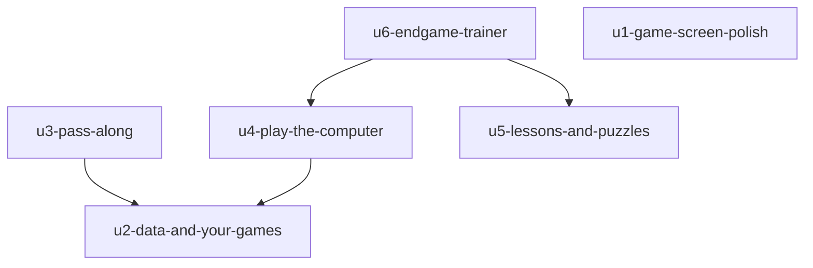

# Unit Dependencies — JustChess P2

This file records topology only: which unit depends on which. It is drawn from `unit-of-work.md`, `inception/domain-design/components.md` and `decisions.md`, and covers `inception/requirements-analysis/requirements.md`. Construction builds one unit at a time in an order that respects these edges [Q2].

## Edges

- **u3-pass-along depends on u2-data-and-your-games.** It needs the schema v4 columns (`mode`, `counted`), the `join_requests` table and the Your games list, which gets the "Join request" pill.
- **u4-play-the-computer depends on u2-data-and-your-games.** It needs `mode = computer`, `computer_level`, the nullable token and `is_computer` on seats, and the Your games list, which shows computer games.
- **u6-endgame-trainer depends on u4-play-the-computer.** It uses the Engine process and queue.
- **u6-endgame-trainer depends on u5-lessons-and-puzzles.** It adds its tab to the trainer hub.

u1-game-screen-polish and u5-lessons-and-puzzles depend on nothing.


<!-- Text fallback: u1, u2 and u5 depend on nothing. u3 and u4 depend on u2. u6 depends on u4 and u5. There is no cycle. -->

## Integration points

| From | To | Integration |
|---|---|---|
| u3 | u2 | Rooms and Games columns, `join_requests` table, summary field `pendingJoinRequest`, the list's pill |
| u4 | u2 | Rooms columns for computer rooms, summary label "Computer, <level>", SavedSeat `kind`/`computerLevel` |
| u6 | u4 | Python call into the Engine queue (`best_move` at skill 20), engine status |
| u6 | u5 | Trainer hub tab registration (ES module), shared trainer progress store |

u1 touches the game screen modules that u3 and u4 also extend. Because units are built one at a time, each unit builds on the previous one's version of those files.

## Parallel development opportunities

None are used. You chose one unit at a time [Q2]. Units without an edge between them still share files (seat authorization and the move route in U3 and U4; the game screen and the Your games list in U1–U4), so building them in parallel would need a merge order. That is not planned (review R-04).

## Walking skeleton

The refactor scope used by this plan runs without a walking-skeleton ceremony, so no unit is marked as the skeleton.

```yaml
units:
  - name: u1-game-screen-polish
    kind: ui
    depends_on: []
  - name: u2-data-and-your-games
    kind: service
    depends_on: []
  - name: u3-pass-along
    kind: service
    depends_on: [u2-data-and-your-games]
  - name: u4-play-the-computer
    kind: service
    depends_on: [u2-data-and-your-games]
  - name: u5-lessons-and-puzzles
    kind: service
    depends_on: []
  - name: u6-endgame-trainer
    kind: service
    depends_on: [u4-play-the-computer, u5-lessons-and-puzzles]
```

## Sources
- `unit-of-work.md`; `inception/domain-design/components.md`, `decisions.md`; `units-generation-questions.md` [Q2]
