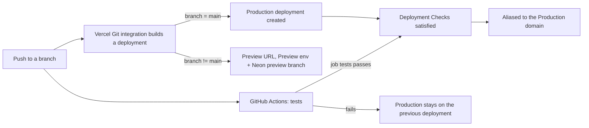

# CD Configuration — JustChess on Vercel

## Sources

- Owner decisions: single production branch `main` (HANDOVER.md, Deployment); Q3 = CI test gate, Q4 = separate Neon branch for Preview (message `ea5c001c`, `deployment-pipeline-questions.md`).
- Repository: `vercel.json` (framework `fastapi`, install command packages the checksum-verified Stockfish, `app.py` function `maxDuration` 300 s, daily cron `17 3 * * *`), new `.github/workflows/tests.yml`.
- Vercel docs read 2026-11-15: Deployment Checks (https://vercel.com/docs/deployment-checks), Git configuration (https://vercel.com/docs/project-configuration/git-configuration), GitHub Actions with the Vercel CLI (https://vercel.com/kb/guide/how-can-i-use-github-actions-with-vercel).
- Build and Test evidence: 465 Python passed / 1 optional skip, Node 230/230 (HANDOVER.md).

## Pipeline

Text fallback: every push runs the `tests` workflow and a Vercel build. Non-`main` branches become Preview deployments. A `main` push creates a Production deployment that Vercel aliases to the Production domain only after the GitHub job `tests` passes; a failing run leaves the previous deployment live.

## Components

| Part | Where | Setting |
|---|---|---|
| CI tests | `.github/workflows/tests.yml` (committed with this stage) | Job id and name `tests`; ubuntu-latest; uv with Python 3.14, `uv sync --frozen`; Node 24 `node --test tests/js/`; `uv run --frozen pytest -q tests` with a `postgres:17` service as `JUSTCHESS_TEST_DATABASE_URL`; runner Chrome via `JUSTCHESS_CHROMIUM`; `STOCKFISH_AUTO_INSTALL=0`. No secrets. |
| Build and deploy | Vercel Git integration (unchanged) | Production branch `main`; install command from `vercel.json`. |
| Production gate | Vercel dashboard → Settings → Deployment Checks → Add Checks → GitHub → `tests` | Requires automatic aliasing for production (on by default). Dashboard-only; no `vercel.json` key exists for it. "Force Promote" bypasses it (emergency only). |
| Preview data | Neon branch (e.g. `preview`) of the production project | Preview-scoped Vercel `DATABASE_URL` = that branch's direct (non-pooled) URL, stored as a Secret. Production keeps its URL. |
| Secrets | Vercel environment variables only | `DATABASE_URL`, `JUSTCHESS_VAPID_PRIVATE_KEY`, `CRON_SECRET` per environment; never in the repo, CI, logs or chat. |

## Fallback if Deployment Checks is unavailable on the Hobby plan

The docs don't state plan availability. If the dashboard offers no Deployment Checks:

1. Add `"git": { "deploymentEnabled": { "main": false } }` to `vercel.json` so the Git integration no longer deploys `main` (Preview branches keep deploying).
2. Add a `deploy` job to the workflow with `needs: tests`, on `push` to `main` only, running `vercel pull --yes --environment=production`, `vercel build --prod`, `vercel deploy --prebuilt --prod`, each with `--token=${{ secrets.VERCEL_TOKEN }}`.
3. Store `VERCEL_TOKEN`, `VERCEL_ORG_ID`, `VERCEL_PROJECT_ID` as GitHub repository secrets (the IDs come from `.vercel/project.json`). Note: `--prebuilt` builds don't get Vercel System Environment Variables at build time; this app reads none at build time.

## Outstanding owner actions (Deployment Execution)

These change external services, so they run only with the owner's go-ahead:

- Push `.github/workflows/tests.yml` and confirm the first run is green on GitHub.
- Enable Deployment Checks with the `tests` check (or apply the fallback).
- Create the Neon preview branch and set the Preview-scoped `DATABASE_URL`; optionally a separate Preview VAPID key and `CRON_SECRET`.
- Run the Preview smoke still owed from Build and Test (WebSockets/reconnect, cross-instance events, assets, cron 401, computer stand-in with the real engine).
